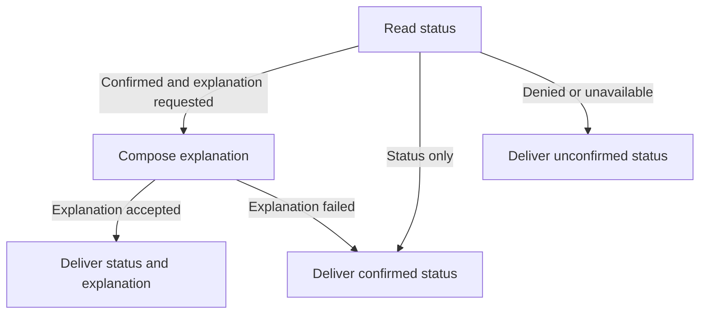

# Design an Agent App from scratch

Build a helpdesk agent that answers “Is the demo service online?” and explains the evidence when the user asks. When a read succeeds, return the status, observation time, and source. When monitoring cannot be accessed, say that the status could not be confirmed. When the explanation fails, keep the confirmed status. This describes where the facts come from, when the model is needed, and what survives a failure before anyone writes a prompt.

Use this page to scope and design the task. In the [hands-on walkthrough](./first-app.en.md), run the same application, inspect its registered graph, review an actual route change, and test successful and unsuccessful paths. If you already have an App, substitute a representative task of your own.

## Define the first deliverable

| Decision | Helpdesk example |
| --- | --- |
| Who can use it | The authenticated user who can read the target service |
| When to call a model | Return status directly for a lookup. When an explanation is needed, have the model compose one sentence from the same verified read |
| Evidence | Monitoring provides `status`, `observedAt`, and `source`. The App checks access and chooses the fields it may disclose |
| What the user receives | Confirmed fields when available, an unconfirmed status when the read fails, and confirmed fields even if explanation fails |
| First acceptance cases | A plain lookup makes one read and zero model calls. Denied access makes zero reads. Invalid wording changes delivery while the read count stays at one |

For an existing project, start with the current request entry, identity source, monitoring port, and tests. For a standalone project, the bundled `create-app.mjs` prints a read-only file plan and generates a Node.js and TypeScript project with `--write`. In an installed project, the `agent-core-app` Skill's `plan.mjs` locates the SDK, development assets, and knowledge configuration. Give a developer or coding assistant the table and a representative request. Ask for the capabilities, deliverable, and acceptance cases, using only approved source material. [Create an App](/manual/create-app) · [Develop with a coding agent](/manual/agent-development)

## Move from a lookup to a workflow

An authenticated handler can invoke a tool, compute a result, and return the status. Use a Workflow when explanation or recovery needs its own path. The Engine runs the declared nodes, applies their state patches, and chooses the first matching route. Reuse the definition and bind request identity and results per run.

- A **tool** owns an authorized operation. Use `Support.defineToolCatalog` for the read's description, schema, parser, authorization, execution, and output check. The App supplies identity and monitoring access.
- A **node** advances the task with an inspectable result. The lookup node returns a validated status. The explanation node uses it to compose wording. Direct delivery can still use the status when explanation fails.
- A **route** decides whether to continue, fall back, or finish. Place a conditional route ahead of the default. Split a step when independent progress, routing, commitment, or recovery justifies the handoff.

Core enforces execution contracts, call budgets, cancellation, and run records. Support assists with tool and context assembly. An App can adopt optional Kits for knowledge, durable approval, or result review while retaining ownership of identity, authorization, and storage. The [mechanics guide](./mechanism.en.md) follows an actual run through these boundaries.

For a larger task, compare three patterns. Use a use-case structure when known business rules drive the work. Use bounded exploration when monitor results determine the next source, with observable progress and a stop condition. Use a lifecycle matrix when multiple decisions reuse hook combinations. Compare them against the same result, authorization paths, failure behavior, and call counts. Give the workflow design Skill the sketch and expected routes to review boundary ownership. [Nodes and tools](/articles/nodes-and-tools) · [Same-task comparison](/manual/examples/organization-comparison) · [Lifecycle matrix](/manual/examples/lifecycle-matrix) · [Workflow design Skill](/development/skills/agent-core-workflow-design)

## Construct the input the model receives

Explanation needs application rules, the current question, and an executed tool receipt. Declare source, trust, lifetime, and character bounds with `Support.defineContextFragments`. Assign rules to `instruction`, questions to user data, and receipts to `tool` data. The App checks and projects permitted fields before assembly. Treat a model proposal as a receipt only after an authorized execution returns a result.

For a follow-up such as “what about the last service?”, retain a few complete recent turns to identify the target and read its current status under current authority. For longer history, project fields, read sections on demand, or choose an explicit compression policy. Preserve recent corrections, critical values, and sources. The current monitoring receipt governs current status. Measure the prepared input with its interaction declarations and send using the same prepared handle. [Prompts and context](/articles/prompts-and-context) · [Context processing API](/manual/api/context-processing) · [Context and delivery scope](/articles/compression-or-partial)

## Budget the remaining work

Identify the model work each route needs. The helpdesk can deliver confirmed status directly. Only explanation needs one call, so the walkthrough sets a one-call limit and bounds output and context. Assert verified fields, monitoring reads, and actual model calls in tests.

For an incident investigation, remove duplicate reads, programmatically computable work, and routine rewrites before budgeting execution, review, and delivery. Set initial allocation in `maxCalls` and the ceiling in `maxTotalCalls`. Use `Support.assessModelBudget` on the bound request, then let the App decide whether to call `adjustCallBudget`. Spent calls, upstream reserves, and the original deadline continue to apply. If input is too large, reduce the input and reassess. A source or permission gap can warrant clarification or delivery within the confirmed scope. [Dynamic call budgets](/articles/reasonable-dynamic-budgets) · [Budget optimization Skill](/development/skills/agent-core-budget-optimization) · [Resilience review Skill](/development/skills/agent-core-resilience-review)

## Design a reply around the task

Take status, time, and citation from the confirmed receipt. Let the model compose the explanation. The App can use `Support.resolveReplyGuidance` to select detail for a user-facing call while preserving explicit requests and material limitations. When output fails a format check, repair using existing work or deliver a deterministic response. Production checks also need to assess fidelity to evidence. An online monitor reading alone leaves the cause of an incident unresolved.

For a structured UI, bind verified fields programmatically and constrain what the model can generate. Use writing samples for style and check facts against current sources. The reply development Skill can review content, format, citations, and tone from the same request, including when the graph stays unchanged. [Reply organization](/articles/reply-organization) · [Reply development Skill](/development/skills/agent-core-reply-development) · [Completion checks and repair](/articles/targeted-completion-repair)

## Inspect and test from the design artifacts

| Artifact | Tool | Evidence |
| --- | --- | --- |
| Registered Workflow and tool catalog | Workflow Inspector | Route priority, references, recovery edges, and authorized recorded executions |
| Before and after registration snapshots | Workflow Diff and change review Skill | Changed declarations and directly affected nodes |
| Representative requests and scripted ports | Offline scenario runner | Deliverable, executed path, authorization, call count, and recovery |
| Feature, node, and tool contracts | Layered App testing | Engine behavior, state commits, parsing, and authorization |
| Examples from the target model and deployment | Model and business integration tests | Evidence fidelity, reply quality, external permissions, and cancellation |

The inspector reads real registrations. Offline cases use fixed replies to reproduce a path. The walkthrough compares two changes. Registration refuses an unconditional route placed first. A broader condition placed first can produce a graph and still shadow the explanation path. Use the diff to find the affected node and an offline scenario to check behavior. In a routine review, give the relevant Skill the registration snapshot, run record, and failing case so its findings can become repeatable assertions. [Workflow development and verification](/manual/workflow-development) · [Diagnose from execution](/articles/observe-real-execution) · [Test under faults](/articles/test-completion-under-faults)

[Start the hands-on walkthrough](./first-app.en.md) · [API reading path](./api-path.en.md) · [Technical articles](/articles/)
