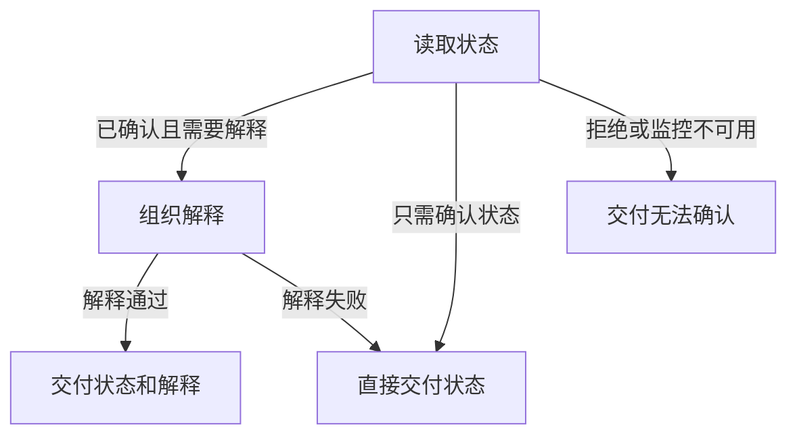

# 从零开始设计 Agent App

做一个服务台 Agent，回答「演示服务现在在线吗？」并在用户需要时解释状态依据。能读取时，交付状态、观察时间和来源。监控不可访问时，回答无法确认。解释失败时，仍交付已经确认的状态。这样描述任务，开发者就能在写模型提示之前确定数据从哪里来、什么时候需要调用模型，以及失败后要保留什么。

本页用同一个案例做立项和设计。跟随[服务台实作](./first-app.md)可以运行工程、检查注册图、比较一次真实路由变更，并验证正常与失败路径。已经有 App 的读者可以直接换成自己的一个代表性任务。

## 定义第一项交付

| 要决定的事 | 这次怎么做 |
| --- | --- |
| 服务谁 | 当前已认证且有权查询目标服务的用户 |
| 升级到模型的条件 | 用户只查状态时直接返回。需要解释时，模型根据同一份已验证的查询结果组织一句话 |
| 证据 | 监控的 `status`、`observedAt` 和 `source`。App 确认访问范围并选择可披露字段 |
| 用户能得到什么 | 查到状态就交付确认的字段。读不到就返回无法确认。解释失败时保留原字段 |
| 首批验收 | 普通查询一次读取、零次模型调用。拒绝访问零次读取。文案异常只降级交付，读取次数仍为一 |

开发已有项目，从 App 的实际请求入口、身份来源、监控端口和测试开始。创建独立工程，可以调用随包的 `create-app.mjs`。它先给出只读文件计划，再用 `--write` 生成 Node.js／TypeScript 工程。已有项目可用 `agent-core-app` Skill 的 `plan.mjs` 定位已安装 SDK、资产和资料配置。把上表和一个真实请求样本交给开发者或编码助手，要求产出能力、交付及验收清单。资料仅使用获准的现有来源。[创建工程](/manual/create-app) · [编码 Agent 辅助开发](/manual/agent-development)

## 从一个查询走到工作流

一个已鉴权的 handler 就能调用工具、计算和返回状态。要为解释和恢复声明独立去向时，用 Workflow 保留节点与路由的关系。Engine 按定义运行，合并节点返回的状态补丁，并选择第一条匹配路由。定义可复用，当前请求的身份和结果保存在本次接线与 state 中。

- **工具**是可授权的操作。以 `Support.defineToolCatalog` 维护状态查询的说明、schema、实际解析、授权、执行和结果检查。App 提供可信身份与监控接口。
- **节点**在任务中推进一个能检查的结果。查询节点交出一份已验证的状态，解释节点只使用它生成文案。解释回落到直接交付时，原状态仍可用。
- **路由**决定什么时候继续、降级或结束。将条件路由放在默认路由前。只有需要独立进度、分支、提交或恢复的工作，才值得承担额外的状态交接。

Core 负责执行合同、调用预算、取消和运行记录。Support 提供工具与上下文装配等辅助。需要资料检索、持久审批或结果评审时，App 可选对应 Kit，并继续持有身份、权限和存储。查看[工作机制](./mechanism.md)了解一次运行怎样完成。

复杂任务可以比较三种范式。固定的业务判断适合用例式；监控结果决定下一份证据时，可以用受限探索，并记录进展和停止条件；多项决策复用生命周期钩子时，再考虑矩阵式。用同一项任务比较交付、授权、失败和调用次数。把节点草图和预期路径交给工作流设计 Skill，检查输入、输出和恢复归属。[节点与工具](/articles/nodes-and-tools) · [同任务组织对照](/manual/examples/organization-comparison) · [生命周期矩阵](/manual/examples/lifecycle-matrix) · [工作流设计 Skill](/development/skills/agent-core-workflow-design)

## 构造模型实际收到的输入

解释阶段只需要三样东西，应用规则、当前问题、已执行工具的回执。用 `Support.defineContextFragments` 声明来源、信任、生命期与字符上限。将规则作为 `instruction`，问题作为用户数据，回执作为 `tool` 数据。应用先校验并投影可披露字段，再装配消息。工具提议要等实际授权和执行后才有可引用的回执。

遇到「那刚才那个服务呢」一类续接，可以保留少量完整近期原文帮助确定对象，再按当前权限读取状态。较长历史按需投影、分段读取或使用显式的压缩策略，保留用户最新纠正、关键数字和来源。当前监控回执仍为时效事实的依据。用 `prepare` 的测量观察包含协议声明的输入，发送时使用同一个准备句柄。[提示与上下文](/articles/prompts-and-context) · [上下文处理 API](/manual/api/context-processing) · [控制输入长度与交付范围](/articles/compression-or-partial)

## 为必要工作分配调用额度

列出每条路径仍需的模型工作。服务台查到状态后，可以直接交付。只有解释路径需要一次调用，实作把上限设为一次，并设置回复输出与上下文边界。测试要同时断言已验证的字段、监控读取次数和实际模型调用次数。

扩展到故障调查时，先去掉重复读取、可由程序完成的统计及例行改写，再按执行、复核和交付估算余量。初始分配是 `maxCalls`，总上限是 `maxTotalCalls`。在已绑定的请求内可用 `Support.assessModelBudget` 评估，再由 App 决定是否调用 `adjustCallBudget`。已花的次数、上游预留和原有期限继续有效。若问题在输入过大，先减少本次输入并重新评估。缺证据或权限时，依据实际阻塞澄清或交付已确认部分。[动态调用预算](/articles/reasonable-dynamic-budgets) · [预算优化 Skill](/development/skills/agent-core-budget-optimization) · [稳健性检查 Skill](/development/skills/agent-core-resilience-review)

## 让答复服务于用户任务

状态、时间和引用直接来自确认过的回执。模型只组织解释文案。应用可用 `Support.resolveReplyGuidance` 为用户答复设置适用的详略，用户明确要求详情时应保留需要的事实和限制。遇到输出格式不合要求，优先从既有成果修复或采用确定性的答复。生产接入还需要判断文字是否与证据一致，例如「在线」并不说明故障原因已经查明。

如果界面需要结构化字段，把状态、来源等确定值交给程序绑定，把生成部分限定在文案。用不同受众的表达示例指导风格，同时用当前来源核对事实。答复开发 Skill 可根据同一请求检查内容、格式、引用与风格，即使流程图没有变化也能使用。[答复组织](/articles/reply-organization) · [答复开发 Skill](/development/skills/agent-core-reply-development) · [完成检查与修复](/articles/targeted-completion-repair)

## 用设计产物驱动检查和测试

| 手头的产物 | 采用的工具 | 核对的事实 |
| --- | --- | --- |
| 真实注册的 Workflow 和工具目录 | Workflow Inspector | 路由优先级、引用、恢复边、已获授权的运行记录 |
| 改动前后的两份注册快照 | Workflow Diff 和变更审查 Skill | 哪个声明改变、直接影响哪些节点 |
| 代表性请求和固定外部端口 | 离线场景运行器 | 最终成果、实际路径、授权、调用次数与恢复 |
| 功能、节点与工具合同 | App 分层测试 | 真实 Engine 的组合、节点状态提交、工具解析和授权边界 |
| 真实语义与运行环境的样本 | 目标模型和业务端口验收 | 证据一致性、答复质量、外部权限和取消表现 |

检查器使用真实注册入口生成快照，离线用例用固定回复复现已知分支。服务台实作会比较两次改动。将无条件路由提前会被注册检查拒绝。将一个覆盖范围更广的条件提前能生成图，解释路径却会被遮蔽。用 diff 找到受影响节点，再通过离线用例验证运行行为。日常评审还可以把注册快照、运行记录和失败案例交给相应 Skill，使建议能落到可重跑的断言。[工作流开发与验证](/manual/workflow-development) · [用运行记录排查](/articles/observe-real-execution) · [故障验收](/articles/test-completion-under-faults)

[开始服务台实作](./first-app.md) · [API 阅读路线](./api-path.md) · [技术分享目录](/articles/)
