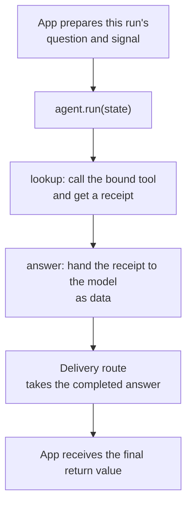

# Understanding the Working Mechanism and Principles from Scratch

Follow a service status request from `agent.run` to the final return. For the helpdesk's design choices and runnable code, see [Plan and design](./design.en.md) and [Build and verify](./first-app.en.md).

A service status Q&A can be split into three explicit processing units: read the actual status, compose the answer, deliver the answer. To understand Agent Core, you do not need to memorize every class name first. Follow this single execution and see how a definition turns into facts.



Process observation runs through this path. It lets the App show status before the final return, without requiring Core to know about pages, HTTP responses, or message tables.

## Before running: check what can be checked first

Before setting off, check everything that can be checked, so you do not break down halfway.

A Workflow created by `defineWorkflow` contains nodes, routes, and ways to finish. It checks whether the definition can actually run, for example whether node IDs are valid, whether route targets exist, whether nodes are reachable, and whether loops pass through a round boundary.

Tools and model interactions also have their own registration contracts. A tool name appearing in a prompt does not mean an executable tool has been registered. A model declaration proposing a capability does not mean the App has authorized executing that capability.

Three kinds of information should be distinguished:

| Information | When it exists | What it can prove |
| --- | --- | --- |
| Definition list | Before running | Which possible capabilities the application has configured |
| Execution facts | When the actual call happens | Which node this run entered, and when the call started or ended |
| Business receipt | After real processing succeeds | The result or side-effect evidence the application actually obtained |

A capability definition states what may be executed; a run record states what was actually executed.

## Entering run: definitions reused, state separated

First stop: `agent.run`. The same Engine can start runs repeatedly, but each run's state must stay its own.

On each `run(state)`, an Engine bound to a Workflow obtains the definitions and model configuration that this run needs. The model Runner on the Workflow path is created within this run, and model call counts accumulate within the corresponding run scope.

So you can reuse fixed definitions and a Provider with no request state, then pass an independent state and signal for each call. Do not treat a standalone `ModelRunner` that has already accumulated call counts as a stateless global HTTP client.

Below are two independent Q&As on the same Agent, with state not reused:

::: code-group

```ts [TypeScript]
import type { AgentCoreEngine } from '@jangts/agent-core';

type State = { question: string; answer?: string };
async function askTwice(agent: AgentCoreEngine<string, State>) {
  const first = await agent.run({ question: '服务在线吗？' });
  const second = await agent.run({ question: '服务延迟是多少？' });
  return { first, second };
}
```

```js [JavaScript]
async function askTwice(agent) {
  const first = await agent.run({ question: '服务在线吗？' });
  const second = await agent.run({ question: '服务延迟是多少？' });
  return { first, second };
}
```

:::

This example only illustrates the scope; it does not mean the second question automatically gains new capabilities. Whether latency can be answered depends on whether the App actually registered and implemented that capability.

## Running a node: check, then execute, then commit

Second stop: entering a node. The execution order of an ordinary node can be understood as follows—

1. Check the cancellation state and the round boundary.
2. Check that the fields in `requires` already exist.
3. Call `run(state, context)` and wait for it to return.
4. Check cancellation again, then validate the returned updates and `provides`.
5. Commit the field updates.
6. In the order the routes are declared, choose the first matching route.
7. Enter the target node, or synchronously compute the final result and validate it.

A node receives a read-only state contract and returns the fields it wants to change. Do not mutate nested objects in place and then expect Core to roll those changes back automatically.

::: code-group

```ts [TypeScript]
import type { WorkflowNode } from '@jangts/agent-core/types';
import { route } from '@jangts/agent-core';

type State = { question: string; answer?: string };
const answerNode: WorkflowNode<State, string> = {
  id: 'answer',
  description: '根据当前问题形成回答',
  requires: ['question'],
  provides: ['answer'],
  run(state) {
    return { answer: `已收到：${state.question}` };
  },
  routes: [route.deliver('answer')],
};
```

```js [JavaScript]
import { route } from '@jangts/agent-core';

const answerNode = {
  id: 'answer',
  description: '根据当前问题形成回答',
  requires: ['question'],
  provides: ['answer'],
  run(state) {
    return { answer: `已收到：${state.question}` };
  },
  routes: [route.deliver('answer')],
};
```

:::

A state commit is a checked field update, not a transaction across external services. Business data already written by a tool, side effects the node itself caused, and route errors that happen only after a commit are not automatically undone. Transactions, idempotency, and compensation are handled by the App that owns the side effects.

## Routes: chosen in order, not all branches executed at once

Third stop: the node has run; routing decides where to go, and only one route is chosen at a time.

An ordinary route's `when` is a synchronous predicate that returns a boolean. The first route without `when` usually serves as the fallback and is placed after the routes that need judgment.

```ts
routes: [
  route.toIfError('failure'),
  route.toIfEqual('answer', 'service.status', 'online'),
  route.to('unavailable'),
]
```

This configuration first checks the `error` already present in state, then checks the actual service status, and finally jumps to the unavailable branch. `toIfError` does not catch exceptions automatically: it reads a state field; where to go after a node throws is configured by `onErrorNodeId`.

Transitioning and delivering are also different. `route.to('answer')` enters another node; `route.deliver('answer')` takes the answer from the current state and ends. `deliverIfReady` lets later routes keep evaluating while the value is not ready; `deliver` requires the delivery field to already exist.

Route predicates and completion functions should both stay synchronous. When an asynchronous check is needed, write the check as a node, wait for the result to be updated into state, and then let an ordinary route choose where to go.

## A round is not a node

Fourth stop: you may instinctively count "how many nodes were traversed", but the budget governs rounds.

`maxRounds` limits bounded rounds, not a simple total node count. The Workflow entry usually starts the first round, and other nodes can run in sequence within the same round.

When the flow returns to a node with `startsRound: true`, it consumes the next round. Definition checks do not allow loops that bypass all round boundaries. So a multi-stage "lookup → review → answer" can consume just one round, while a loop that retries repeatedly must be constrained by rounds.

Rounds, model call counts, character budget, token budget, and tool authorization each express different limits. Raising `maxRounds` does not automatically grant more business permissions, nor does it expand some mysterious vendor context window.

## Model calls: prepare the protocol first, accept only complete results

Fifth stop: time to compose the answer. This is where the fetched receipt is actually handed to the model.

Calling a model inside a Workflow node generally needs only:

```ts
const { value, invocation } = await context.model.invoke({
  input: state.question,
});
```

The model configuration is already bound to the Agent, and Core connects this call to the current node's cancellation, budget, and diagnostics scope. `value` is the result parsed through the current transport; `invocation` is the actual call metadata generated by Core.

Both plain text and structured output use `{ value, invocation }`. When you switch to a structured interaction, what changes is the type of `value`; you do not need to learn another return shape. Errors propagate through a rejected Promise.

A complete call roughly goes through:

```text
Select the registered model/transport
 → Prepare instructions, Schema, options, and the collector factory
 → Assemble the actual messages and check the input budget
 → Acquire this call's quota and request the Provider
 → Receive chunks, delivering transient output as needed
 → Collect the complete result, run parsing and contract checks
 → Form the invocation receipt, then return value
```

The Provider receives generic model messages and the execution context; transport details such as vendor HTTP and SSE can be implemented by Support adapters. Custom Providers also follow the same `stream(messages, context)` contract.

A streaming chunk is a model proposal that has not been fully validated. You must not perform a business write just because a chunk looks like a tool name; wait until protocol collection, argument parsing, capability selection, and actual authorization have all completed.

## Advanced measurement: one preparation, keep using the same invoke

A side branch on the way: if you want to know in advance whether the input will exceed the budget, you can prepare a measurement first.

An ordinary call does not require an upfront `prepare`. When a context node needs to determine whether the budget is exceeded, you can first take a snapshot of the transport for this run, measure the candidate input, process it, and then hand the same handle to `invoke`.

::: code-group

```ts [TypeScript]
import type { WorkflowModel } from '@jangts/agent-core/types';

async function answerWithMeasuredInput(model: WorkflowModel, input: string) {
  const prepared = model.prepare({ stageId: 'answer', maxOutputTokens: 512 });
  const measurement = prepared.measure(input);
  if (!measurement.withinBudget) {
    throw new RangeError('输入需要先经过已配置的上下文处理节点');
  }
  return model.invoke({ input, prepared });
}
```

```js [JavaScript]
async function answerWithMeasuredInput(model, input) {
  const prepared = model.prepare({ stageId: 'answer', maxOutputTokens: 512 });
  const measurement = prepared.measure(input);
  if (!measurement.withinBudget) {
    throw new RangeError('输入需要先经过已配置的上下文处理节点');
  }
  return model.invoke({ input, prepared });
}
```

:::

Measurement reuses the instructions, Schema, and options of that same preparation, preventing a dynamic transport from switching to a different configuration between "measure" and "send". Repeated measurement does not consume model calls; the final send still re-checks the actual input, and a measurement result is not a quota reservation or a pass.

A handle belongs to the run and model that prepared it and can be consumed only once; you cannot reuse it across requests, nor simultaneously replace its stage, interaction, and output reservation. Without an explicit counter, Core does not guess the conversion between characters and tokens.

## Context processing: ordinary nodes own the policy, Core keeps the final check

Before the next stop, handle the context: with more materials and longer history, someone has to compress. The policy belongs to ordinary nodes; the final check stays in Core.

Selecting materials, retaining recent history, and compressing redundant content require business semantics. Recommended algorithms are provided by Support, and can also be replaced by third-party or App-implemented ordinary nodes.

The App decides in the Workflow when to enter a selection/compression node, and the flow continues after the node produces updates. Core does not secretly insert a Support-only flow because of some private mode.

Context processing observes the following boundaries:

- The current question, required permission conditions, and protected sources must not silently disappear under the name of "successful compression".
- Model requests inside a processing node are also bound by the current request's quota and cancellation; they cannot draw a fresh full budget.
- The compressed input is still checked before it is really sent to the Provider; if the budget cannot be safely met, the run may fail explicitly.
- Whether it actually entered, completed, or failed is presented through ordinary node events; it cannot be merely claimed in report text.

For node configuration and examples, see [Context Processing](/manual/api/context-processing).

## Tool calls: validate and authorize first, then turn the result into a receipt

Sixth stop—the real receipt is here: the model can only say "I want to look it up"; the tool is what actually completes the query.

The tool execution path and the model generation path exist separately. The model can propose "query the status", but only a tool runtime registered by the App can really complete the query.

The Core tool mechanism parses input, invokes the handler, parses output, and checks cancellation before succeeding. Support's tool definitions also provide explicit authorization handling and generate the schema and the model-visible capability from the same capability declaration, reducing duplication.

A node calls an already bound tool:

```ts
const { value, invocation } = await context.tools.invoke({
  toolId: 'get_status',
  input: {},
});
```

`value` is the actual result after output parsing. `invocation` is tool call metadata—not a user ID, not a message ID, and not evidence that "the system has now authorized performing arbitrary operations".

The low-level `ToolRegistry` accepts executable tool contracts; if you implement it directly, the App must put authorization into its own execution path. When using the Support tool catalog, implement `authorize` properly. `kind: 'read'` is only a declaration; it does not automatically verify for you whether a user can read that service.

## Cancellation and errors: late results cannot be committed as success

Seventh stop: you may be stopped at any point along the way. Cancellation and errors must keep latecomers from slipping through.

A request can pass a cancellation signal through `agent.run(state, { signal })`. It constrains the run together with the configured lifecycle; nodes and external services should keep propagating that signal downward.

Core checks cancellation again at several boundaries, including after waiting for a node to return and before accepting the final result. Even if an external operation that does not support cancellation returns later, it cannot be committed as the current task's successful result. Whether the external side effect itself has already occurred still depends on the cancellation, idempotency, and reconciliation capabilities of the service the App relies on.

| Case | Common destination |
| --- | --- |
| An ordinary node throws a business or external service error | If `onErrorNodeId` is set, enter the registered error node; otherwise reject to the caller |
| Missing required state, a wrong route contract, or a final result that violates the agreement | A Workflow contract error, which does not automatically enter the fallback as an ordinary business failure |
| The request is cancelled | Exit the current run and do not continue into an error node to publish a successful answer |
| Model input, output, or call count exceeds the limit | Preserve the corresponding error faithfully; the same task's budget cannot be reset by creating another Runner |

Recovery nodes should also have their own input and completion checks. "An exception occurred" does not mean "any fallback text may be emitted".

## Real-time observation and content delivery have different guarantees

Eighth stop: your colleague wants to see progress. But observation is a side channel; do not treat it as the business itself, and do not collect things you should not collect just to show that you are "busy".

Observation is registered through `execution.observe`. Metadata can be observed even without a persistent log output; to receive content that nodes report themselves, you must explicitly select the corresponding content events.

::: code-group

```ts [TypeScript]
import type { ExecutionObserver } from '@jangts/agent-core/types';

const observer: ExecutionObserver = {
  accepts({ event, content }) {
    return content === 'metadata' || event === 'node.progress';
  },
  event(fact) {
    if (fact.type === 'node.progress') {
      console.log('节点进度', fact.workflowNodeId, fact.payload.payload);
    } else {
      console.log('执行事实', fact.type, fact.workflowNodeId);
    }
  },
};
```

```js [JavaScript]
const observer = {
  accepts({ event, content }) {
    return content === 'metadata' || event === 'node.progress';
  },
  event(fact) {
    if (fact.type === 'node.progress') {
      console.log('节点进度', fact.workflowNodeId, fact.payload.payload);
    } else {
      console.log('执行事实', fact.type, fact.workflowNodeId);
    }
  },
};
```

:::

Inside a node, `context.report({ usedModel, payload, subs })` provides the report, and the Loop fills in execution identity and correlation. usedModel is an optional boolean flag of the node itself and stays unknown when not reported; subs must be the current execution instance created by `context.createStepRecorder()`, which records intent first with write, completes results with fix, and reads snapshots with readAll, and does not accept hand-written arrays. Writes and completions reuse the existing log outlet, and short-circuiting still keeps the plans already emitted; body text is still controlled by the original content switches. Nodes do not need to create spans themselves or pass diagnostics layer by layer to bound models/tools; for the complete contract, see [Sub-log Instances](/manual/api/observability#sub-log-instances-and-record-first-then-complete).

Observation is a side channel: a failing listener does not change the business result. The model output sink is a content delivery port: it waits in order, preserves backpressure, and propagates delivery failures. Both share execution fact types, but unified types must not cause either of them to lose its own timing guarantees.

"Starting a model request" is enough for the App to show "thinking"; it does not mean Core has obtained, or should expose, the model's internal reasoning process. Model text, tool facts, transient previews, and the final answer also need to be handled separately.

## After the final return, the App still owns records and presentation

Final stop: `agent.run` has returned, but wrapping up the story belongs to the App.

`agent.run` returns the final Result declared by the Workflow. The unified call results of models and tools do not force the App to also return `{ value, invocation }` in the end: the external App result is decided by its own Workflow contract.

The App can store user input and final output in message records and link them to the corresponding Core run. Core execution identity does not mix into App message or account semantics; the database, retention period, redaction, and read authorization continue to be defined by the App.

Next, you can use the [complete offline tutorial](./first-app.md) to build this call chain yourself. When you need to review a specific field, overload, or policy, enter the corresponding definition from the layered API catalog.

## Check the mock service along the same protocol

To re-verify the whole chain offline, use the Mock service and follow the same protocol.

MockGPT Kit's generate only produces data; fetch is what carries HTTP/SSE transport semantics; the minimal Node service exposes the same fetch adapter to other processes. Stream chunks, network byte blocks, completion frames, and cancellation are still handled by the real client.

::: code-group

```ts [TypeScript]
import { MockGPT } from '@jangts/agent-core/mock';
import { createMockServer } from '@jangts/agent-core/mock/node';
const mock = new MockGPT({ rules: [{ generator: '服务在线。' }] });
const server = createMockServer({ mock });
try {
  const { url } = await server.listen({ port: 0 });
  const response = await fetch(`${url}/v1/chat/completions`, {
    method: 'POST', body: JSON.stringify({ model: 'demo', messages: [{ role: 'user', content: '服务状态' }] }),
  });
  console.log(await response.json());
} finally { await server.close(); }
```

```js [JavaScript]
import { MockGPT } from '@jangts/agent-core/mock';
import { createMockServer } from '@jangts/agent-core/mock/node';
const mock = new MockGPT({ rules: [{ generator: '服务在线。' }] });
const server = createMockServer({ mock });
try {
  const { url } = await server.listen({ port: 0 });
  const response = await fetch(`${url}/v1/chat/completions`, {
    method: 'POST', body: JSON.stringify({ model: 'demo', messages: [{ role: 'user', content: '服务状态' }] }),
  });
  console.log(await response.json());
} finally { await server.close(); }
```

:::

Web sources belong to the explicitly enabled Node Kit. By default, network fetching checks the target and redirects; when load is injected, trusted configuration provides the body and takes on the transport boundary, and source data is still not authorization. Offline tests can return a restricted fixed body and then hand it to generators such as summary; for details, see [MockGPT Sources and Generation Policies](/manual/api/mock).
