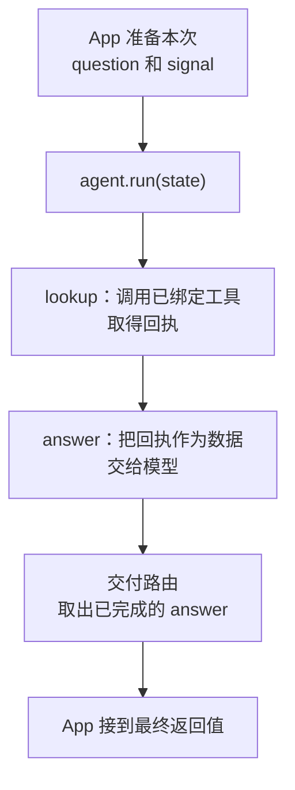

# 从零理解工作机制和原理

从 `agent.run` 到最终返回，这一页沿一次服务状态查询解释运行合同。服务台的设计取舍与可运行代码见[立项与设计](./design.md)和[实作与验证](./first-app.md)。

一次服务状态问答，可以分成三个明确的处理单元：读取实际状态、组织回答、交付回答。理解 Agent Core，不必先记住全部类名。先沿着这一次执行，看清定义如何变成事实。



过程监听贯穿这条路径。它能让 App 在最终返回前显示状态，不要求 Core 知道页面、HTTP 响应或消息表。

## 运行前：把可以检查的关系先检查

发车之前，先把能检查的都查一遍，免得开到一半抛锚。

`defineWorkflow` 创建的 Workflow 包含节点、路由和结束方式。它会检查定义是否能实际运行，例如节点 ID 是否有效、路由目标是否存在、节点是否可达，以及循环是否经过轮次边界。

工具和模型传输也有各自的注册合同。同一个工具名出现在提示词里，不等于已经注册了可执行工具。某个模型声明可以提出一种能力，也不等于 App 已授权执行这种能力。

应区分三份信息：

| 信息 | 何时存在 | 能证明什么 |
| --- | --- | --- |
| 定义清单 | 运行之前 | 应用配置了哪些可能能力 |
| 执行事实 | 实际调用发生时 | 这次进入了哪个节点，调用何时开始或结束 |
| 业务回执 | 真实处理成功之后 | 应用实际取得的结果或副作用凭据 |

能力定义说明可以执行什么，运行记录说明实际执行了什么。

## 进入 run：定义复用，状态分开

第一站：`agent.run`。同一个 Engine 可以反复开跑，但每次的 state 必须各归各。

绑定 Workflow 的 Engine 在每次 `run(state)` 时，取得本次运行所需的定义和模型配置。Workflow 路径中的模型 Runner 在这次运行内创建，模型调用次数也在相应运行作用域内累计。

因此可以复用固定定义和无请求状态的 Provider，再为每次调用传入独立 state、signal。不要把已经累计了调用次数的独立 `ModelRunner` 当成一个无状态的全局 HTTP 客户端。

下面是同一 Agent 的两次独立问答，state 不复用：

::: code-group

```ts [TypeScript]
import type { AgentCoreEngine } from '@jangts/agent-core';

type State = { question: string; answer?: string };
async function askTwice(agent: AgentCoreEngine<string, State>) {
  const first = await agent.run({ question: '服务在线吗？' });
  const second = await agent.run({ question: '服务延迟是多少？' });
  return { first, second };
}
```

```js [JavaScript]
async function askTwice(agent) {
  const first = await agent.run({ question: '服务在线吗？' });
  const second = await agent.run({ question: '服务延迟是多少？' });
  return { first, second };
}
```

:::

该示例只说明作用域，不表示第二个问题会自动获得新能力。能否回答延迟，取决于 App 是否真的登记并实现了该能力。

## 运行节点：先检查，再执行，再提交

第二站：进入节点。一个普通节点的执行顺序可以这样理解——

1. 检查取消状态和轮次边界。
2. 检查 `requires` 字段已经存在。
3. 调用 `run(state, context)`，等待它返回。
4. 再检查取消，验证返回更新和 `provides`。
5. 提交字段更新。
6. 按路由声明顺序，选择第一条命中的路由。
7. 进入目标节点，或者同步计算最终结果并检查它。

节点接收只读的状态合同，返回自己要修改的字段。不要原地改嵌套对象，再指望 Core 把这些修改自动回滚。

::: code-group

```ts [TypeScript]
import type { WorkflowNode } from '@jangts/agent-core/types';
import { route } from '@jangts/agent-core';

type State = { question: string; answer?: string };
const answerNode: WorkflowNode<State, string> = {
  id: 'answer',
  description: '根据当前问题形成回答',
  requires: ['question'],
  provides: ['answer'],
  run(state) {
    return { answer: `已收到：${state.question}` };
  },
  routes: [route.deliver('answer')],
};
```

```js [JavaScript]
import { route } from '@jangts/agent-core';

const answerNode = {
  id: 'answer',
  description: '根据当前问题形成回答',
  requires: ['question'],
  provides: ['answer'],
  run(state) {
    return { answer: `已收到：${state.question}` };
  },
  routes: [route.deliver('answer')],
};
```

:::

状态提交是受检查的字段更新，不是跨外部服务的事务。工具已经写出的业务数据、节点自己造成的副作用，以及已经提交后才发生的路由错误，不会被自动撤销。事务、幂等和补偿由拥有副作用的 App 处理。

## 路由：按顺序选择，不同时执行全部分支

第三站：节点跑完，去向靠路由决定，而且一次只挑一条。

普通路由的 `when` 是同步谓词，返回布尔值。第一条没有 `when` 的路由通常用作兜底，放在需要判断的路由之后。

```ts
routes: [
  route.toIfError('failure'),
  route.toIfEqual('answer', 'service.status', 'online'),
  route.to('unavailable'),
]
```

这段配置先检查状态中已有的 `error`，再检查实际服务状态，最后跳转到不可用分支。`toIfError` 不是自动捕捉异常：它读取状态字段；节点抛错后的去向由 `onErrorNodeId` 配置。

跳转与交付也不同。`route.to('answer')` 进入另一个节点；`route.deliver('answer')` 取出当前状态中的回答并结束。`deliverIfReady` 在值尚未准备好时允许后面的路由继续判断；`deliver` 则要求交付字段已经存在。

路由谓词和完成函数都应保持同步。需要异步检查时，把检查写成节点，等待结果更新进 state，再由普通路由选择去向。

## 一轮不等于一个节点

第四站：你可能下意识去数“走了几个节点”，但预算管的是轮次。

`maxRounds` 限制有边界的轮次，而不是简单的节点总数。Workflow 入口通常开始第一轮，其他节点可以在同一轮中按顺序执行。

当流程回到一个 `startsRound: true` 的节点时，会消费下一轮。定义检查不允许存在绕过所有轮次边界的循环。因此多阶段的“查询→复核→回答”可以只消耗一轮，而一个反复重试的环必须受到轮次约束。

轮次、模型次数、字符预算、token 预算和工具授权各自表达不同限制。把 `maxRounds` 调大，不会自动授予更多业务权限，也不会扩大神秘的供应商上下文窗口。

## 模型调用：先准备协议，后接受完整结果

第五站：轮到组织回答了。这里才真正把查到的回执交给模型。

在 Workflow 节点中调用模型，一般只需要：

```ts
const { value, invocation } = await context.model.invoke({
  input: state.question,
});
```

模型配置已经绑定在 Agent 上，Core 把这次调用接到当前节点的取消、预算和诊断作用域。`value` 是通过当前传输解析后的结果，`invocation` 是 Core 生成的实际调用元数据。

纯文本和结构化输出都使用 `{ value, invocation }`。改用结构化传输时，变化的是 `value` 的类型，不需要重新学习另一种返回外形。错误通过拒绝的 Promise 传播。

完整调用大致经过：

```text
选择已登记模型／传输
 → 准备指令、Schema、选项和收集器工厂
 → 组装实际消息并检查输入预算
 → 取得本次调用额度并请求 Provider
 → 接收分片，按需交付暂态输出
 → 收集完整结果，执行解析与合同检查
 → 形成调用回执，再返回 value
```

Provider 收到的是通用模型消息和执行 context；供应商 HTTP、SSE 等传输细节可以由 Support 的适配器实现。自定义 Provider 也遵守相同的 `stream(messages, context)` 合同。

流式分片是尚未验证完的模型提议。不能看见一个类似工具名的分片，就立即执行业务写入；应等协议收集、参数解析、能力选择和实际授权均完成。

## 进阶测量：同一次准备，继续使用同一个 invoke

顺路一支线：想提前知道输入会不会超预算，可以先准备一份测量。

普通调用不要求提前 `prepare`。需要在上下文节点中判断是否超预算时，可以先取得本次传输快照，测量候选输入，处理后再把同一个句柄交给 `invoke`。

::: code-group

```ts [TypeScript]
import type { WorkflowModel } from '@jangts/agent-core/types';

async function answerWithMeasuredInput(model: WorkflowModel, input: string) {
  const prepared = model.prepare({ stageId: 'answer', maxOutputTokens: 512 });
  const measurement = prepared.measure(input);
  if (!measurement.withinBudget) {
    throw new RangeError('输入需要先经过已配置的上下文处理节点');
  }
  return model.invoke({ input, prepared });
}
```

```js [JavaScript]
async function answerWithMeasuredInput(model, input) {
  const prepared = model.prepare({ stageId: 'answer', maxOutputTokens: 512 });
  const measurement = prepared.measure(input);
  if (!measurement.withinBudget) {
    throw new RangeError('输入需要先经过已配置的上下文处理节点');
  }
  return model.invoke({ input, prepared });
}
```

:::

测量复用同一次准备的指令、Schema 和选项，避免动态传输在“测量”与“发送”之间换了一套配置。反复测量不消耗模型调用；最终发送仍会重新检查实际输入，测量结果不是额度预约或放行凭证。

句柄属于准备它的运行和模型，只能消费一次；不能拿它跨请求复用，也不能同时替换其阶段、传输和输出预留。没有明确的计数器时，Core 不猜字符与 token 的换算。

## 上下文处理：普通节点负责策略，Core 保留最终检查

下一站之前先处理上下文：资料多了、历史长了，总得有人压一压。策略归普通节点，最终检查留在 Core。

资料选择、保留最近历史、压缩冗余内容，需要业务语义。推荐算法由 Support 提供，也可以替换为第三方或 App 自己实现的普通节点。

App 在 Workflow 中决定何时进入选择／压缩节点，节点产生更新后继续后续流程。Core 不会因为某个私有模式，偷偷插入一套 Support 专用流程。

上下文处理遵守以下边界：

- 当前问题、必要权限条件和受保护来源不能在“压缩成功”的名义下悄悄丢失。
- 处理节点内部的模型请求也受当前请求的额度和取消约束，不能重新领一份完整预算。
- 压缩后的输入仍在真正发往 Provider 前检查；无法安全满足预算，可以明确失败。
- 实际进入、完成或失败由普通节点事件呈现，不能仅在报告文字中声称执行过。

节点配置及示例见[上下文处理](/manual/api/context-processing)。

## 工具调用：先校验和授权，再把结果变成回执

第六站——真正的回执在这里：模型只能说“想查”，真正把查询做完的是工具。

工具执行路径与模型生成路径分别存在。模型可以提出“查询状态”，只有 App 登记的工具运行时才能真的完成查询。

Core 工具机制执行输入解析、处理器调用、输出解析，并在成功前检查取消。Support 的工具定义还提供明确的授权处理，在同一能力声明中生成 schema 和模型可见能力，减少重复。

节点调用已经绑定的工具：

```ts
const { value, invocation } = await context.tools.invoke({
  toolId: 'get_status',
  input: {},
});
```

`value` 是经过输出解析的实际结果。`invocation` 是工具调用元数据，而不是用户 ID、消息 ID，也不是“当前系统已经授权执行任意操作”的凭证。

低层 `ToolRegistry` 接受可执行工具合同；如果直接实现它，App 需要把授权放进自己的执行路径。使用 Support 工具目录时，应认真实现 `authorize`。`kind: 'read'` 只是声明，不会替你自动校验某个用户是否能读该服务。

## 取消与错误：迟到结果不能继续成功提交

第七站：路上随时可能被叫停。取消与错误要让迟到者不能蒙混过关。

请求可以通过 `agent.run(state, { signal })` 传入取消信号。它与已配置生命周期一起约束运行；节点与外部服务应继续向下传递该信号。

Core 在若干边界再次检查取消，包括等待节点返回之后和接受最终结果之前。即使某个不支持取消的外部操作后来返回，它也不能被当成当前任务的成功结果继续提交。外部副作用本身是否已发生，仍需 App 依赖服务的取消、幂等和对账能力。

| 情况 | 常见去向 |
| --- | --- |
| 普通节点抛出业务或外部服务错误 | 有 `onErrorNodeId` 时进入已登记错误节点，否则向调用方拒绝 |
| 缺少必要状态、错误的路由合同或最终结果不符合约定 | Workflow 合同错误，不作为普通业务失败自动进入兜底 |
| 请求被取消 | 退出当前运行，不继续走错误节点发布成功回答 |
| 模型输入、输出或次数超限 | 如实保留对应错误；不能通过再建 Runner 重置同一任务预算 |

恢复节点也应有自己的输入和完成检查。“发生异常”不等于“允许输出任何兜底正文”。

## 实时观察与内容交付有不同保证

第八站：同事想看到进度。但观察是旁路，别把它当成业务本身，也别为了显示“忙碌”去收集不该收集的东西。

监听通过 `execution.observe` 注册。无持久日志输出时也能监听元数据；希望接收节点自报内容时，要明确选择相应内容事件。

::: code-group

```ts [TypeScript]
import type { ExecutionObserver } from '@jangts/agent-core/types';

const observer: ExecutionObserver = {
  accepts({ event, content }) {
    return content === 'metadata' || event === 'node.progress';
  },
  event(fact) {
    if (fact.type === 'node.progress') {
      console.log('节点进度', fact.workflowNodeId, fact.payload.payload);
    } else {
      console.log('执行事实', fact.type, fact.workflowNodeId);
    }
  },
};
```

```js [JavaScript]
const observer = {
  accepts({ event, content }) {
    return content === 'metadata' || event === 'node.progress';
  },
  event(fact) {
    if (fact.type === 'node.progress') {
      console.log('节点进度', fact.workflowNodeId, fact.payload.payload);
    } else {
      console.log('执行事实', fact.type, fact.workflowNodeId);
    }
  },
};
```

:::

节点内部使用 `context.report({ usedModel, payload, subs })` 提供报告，由 Loop 补齐执行身份和关联。usedModel 是节点自身的可选布尔标记，未上报保持未知；subs 必须是 `context.createStepRecorder()` 创建的本次执行实例，通过 write 先记意图、fix 补结果、readAll 读快照，不接收手写数组。写入和补全复用既有日志出口，短路仍保留已送出的计划；正文仍受原内容开关控制。节点不必自己创建 span 或把 diagnostics 逐层传给已绑定的模型／工具，完整合同见[子日志实例](/manual/api/observability#子日志实例与先记后补)。

观察是旁路：监听器失败不会改变业务结果。模型输出 sink 是内容交付端口：按顺序等待，保留背压并传播交付失败。两者共用执行事实类型，但不能因为类型统一，就丢掉各自的时序保证。

“开始请求模型”足以让 App 显示“正在思考”，它不表示 Core 已获得或应当公开模型的内部思维过程。模型文本、工具事实、暂态预览与最终答案也需要分别处理。

## 最终返回后，App 继续拥有记录与展示

终点站：`agent.run` 返回了，但故事的收尾归 App。

`agent.run` 返回 Workflow 声明的最终 Result。模型和工具的统一调用结果不会强迫 App 最终也返回 `{ value, invocation }`：外部 App 结果由自己的 Workflow 合同决定。

App 可以将用户输入和最终输出保存在消息记录中，再关联相应 Core run。Core 执行身份不混入 App 消息或账号语义，数据库、保留期、脱敏和读取授权继续由 App 定义。

接下来可以用[完整离线教程](./first-app.md)亲自建立这条调用链。需要审查某个字段、重载或策略时，再从分层 API 目录进入对应定义。

## 沿同一协议检查模拟服务

想整条链离线复验一遍，就用 Mock 服务，沿同一协议走。

MockGPT Kit 的 generate 只生成数据，fetch 才负责 HTTP/SSE 传输语义；最小 Node 服务把相同 fetch 适配提供给其他进程。流分片、网络字节块、完成帧和取消继续由真实客户端处理。

::: code-group

```ts [TypeScript]
import { MockGPT } from '@jangts/agent-core/mock';
import { createMockServer } from '@jangts/agent-core/mock/node';
const mock = new MockGPT({ rules: [{ generator: '服务在线。' }] });
const server = createMockServer({ mock });
try {
  const { url } = await server.listen({ port: 0 });
  const response = await fetch(`${url}/v1/chat/completions`, {
    method: 'POST', body: JSON.stringify({ model: 'demo', messages: [{ role: 'user', content: '服务状态' }] }),
  });
  console.log(await response.json());
} finally { await server.close(); }
```

```js [JavaScript]
import { MockGPT } from '@jangts/agent-core/mock';
import { createMockServer } from '@jangts/agent-core/mock/node';
const mock = new MockGPT({ rules: [{ generator: '服务在线。' }] });
const server = createMockServer({ mock });
try {
  const { url } = await server.listen({ port: 0 });
  const response = await fetch(`${url}/v1/chat/completions`, {
    method: 'POST', body: JSON.stringify({ model: 'demo', messages: [{ role: 'user', content: '服务状态' }] }),
  });
  console.log(await response.json());
} finally { await server.close(); }
```

:::

网页来源属于显式启用的 Node Kit。默认网络抓取检查目标及重定向；注入 load 时由可信配置提供正文并承担传输边界，源数据仍不是授权。可在离线测试中返回受限的固定正文，再交给 summary 等生成器，详见 [MockGPT 来源与生成策略](/manual/api/mock)。
