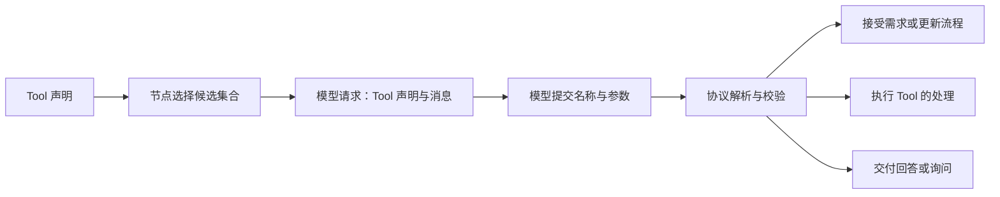
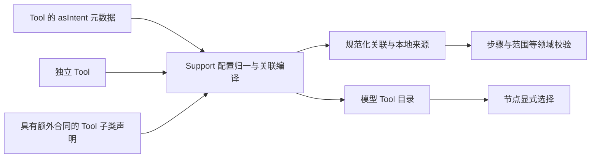

# 0.5.0 Tool 概念与关联注册调整提案

本文记录以 0.3.6 为基线的设计与迁移方案，目标版本为 **0.5.0**，跳过 0.4 系列。公开接口以源码及 API 手册为准，实施与验证证据单独记入维护记录；版本调整不代表已经发布 npm。

## 1. 目标与边界

此次调整有两个目标：减少开发者必须先学习的一级概念；减少描述、Schema、实现入口和注册关系的重复配置。

概念收敛不等于删除已有设计。集中注册、工具与协议的关联、来源追踪、步骤约束与统一校验应按实际职责复用；已取消的实体关系不为兼容旧结构而保留。不能只把多个注册表换成一张大表，再要求使用者填写同样多的内容。

模型侧供选择和提交参数的接口统一称为 **Tool**，以 Base Tool 承载共同合同。不引入 Action 这个一级概念，现有执行职责仍归 Tool。Intent 只作为 Tool 的用途标记和专门描述，不再是独立注册实体，没有独立 ID、注册表或与 Tool 的多对多关系。

原注册类型若与 Base Tool 职责相同，直接合并；只有确实增加字段、行为或约束时，才作为 Tool 的子类。不能只为保留旧名称建立空子类，也不能因为某个对象包含一个 toolId 引用就将其整体变为 Tool。具体采用接口扩展还是运行时类继承，结合现有实现确定，不为概念收敛强制引入类实例。

Node、Workflow、模型阶段、Provider、上下文装配、预算、取消、鉴权与日志继续保有职责。它们不因参与模型调用而全部改为 Tool。普通消息和结构化输出同样保留，不强迫所有模型输出采用工具调用。

## 2. 先区分模型接口与程序执行



Tool 可以接受需求、识别意图、请求操作或提交回答。Tool 不要求对应一个同名业务函数，也不要求发生业务写入。参数解析和结果映射在程序侧执行，模型只接触选定的声明。

Tool 的实际处理可以查询、计算、校验或写入，不限于有副作用的操作。带执行职责的 Tool 可以由程序直接调用，也可接受模型提议；其授权、执行和输出校验属于相对 Base Tool 的真实扩展，可以据此建立子类。模型调用不能越过授权、输入输出校验、预算和取消边界。

## 3. 现有概念如何处理

| 当前项 | 进入模型的部分 | 拟议处理 | 保留的本地职责与关系 |
| --- | --- | --- | --- |
| ModelCapability | 名称、描述、参数 Schema | 收敛为 Tool | 参数解析、同步 resolve、阶段选择和传输适配 |
| 现有执行 Tool | 模型可见描述与 Schema | 在 Base Tool 上保留实际增加的执行合同，可据此扩展 Tool | authorize、execute、输出校验、事件、预算、取消 |
| Intent | 需求描述 | 收入 Tool 的 asIntent 属性；取消独立实体与 ID | 任务目标和领域约束迁至实际负责的节点、任务或 Tool，不保留 Intent 注册关系 |
| Scope | 可选范围及必要说明 | 作为相关 Tool 参数或上下文 | 真实数据源映射、权限和证据要求 |
| Step / Next | 可选决定及参数 | 可选接口由 Tool 表达，或保留现有结构化协议 | 允许集合、协议映射、完成检查；不把集合误作执行顺序 |
| Protocol / 输出变体 | 输出 Schema、字段语义 | Tool 或输出协议的组成部分 | 校验、解析、预览和分发 |
| Context Fragment | 指令、资料、历史及状态内容 | 保留上下文装配 | 来源、信任、生命周期和预算 |
| Policy / Guidance | 模型应遵守的说明 | 消息或 Tool 使用说明 | 实际检查与恢复逻辑 |
| Skill / 知识目录 | 适用说明及按需加载内容 | 保留按需上下文 | 加载、检索、真实资料访问 |
| 输出模板 / 语义占位符 | 合法格式与填写规则 | 输出合同 | 本地替换、渲染和校验 |
| sources（注册贡献来源） | 当前可被序列化到上下文 | 默认留在本地，不整体上报 | 描述聚合、关系筛选、诊断及来源检查 |
| Node / routes / Stage | 不自动提交注册定义 | 不在本次收敛对象内 | 控制流、模型调用时机和候选组织 |

关系信息与 sources 不是同一件事。Tool 可以携带必要的关系标识，程序也可直接查关联表，不依赖整份 sources。资料检索结果的事实来源与引用证据不属于这里的注册 sources，不能一并删除。

### 3.1 基类与子类接口草案

以下展示完整的共同字段与各层增量，不是已发布类型声明。BaseTool 是共同合同的工作名，是否公开简称 Tool 在导出设计中统一。类型继承不要求所有对象都改为 class。

```text
BaseTool
├── ExecutableTool      增加授权、实际执行、结果校验
├── LifecycleTool       增加原生命周期执行合同、步骤和上下文贡献
├── DomainToolDefinition 增加可选领域策略及步骤约束
│   └── GoalTool        Cafe 的具体范围、目标与交付约束
└── PreviewTool         增加模型输出预览合同

ModelCapability → 合并到 BaseTool，不另留同义子类
@WorkflowTool  → 声明上述 Tool 的装饰器入口，不另造 WorkflowTool 子类
```

#### BaseTool：共同的模型接口

```ts
type ToolCondition<Context> =
  | boolean
  | ((context: Readonly<Context>) => boolean);

interface IntentOptions<Context> {
  readonly description?: string;
  readonly when?: (context: Readonly<Context>) => boolean;
  readonly steps?: readonly string[];
}

type AsIntent<Context> =
  | true
  | string
  | ((context: Readonly<Context>) => boolean)
  | IntentOptions<Context>;

interface ToolResolveContext {
  readonly stageId: string;
}

interface BaseTool<Input = unknown, Selection = Input, Context = unknown> {
  readonly id: string;
  readonly description: string;
  readonly inputSchema: SchemaAdapter<Input>;

  readonly active?: ToolCondition<Context>;
  readonly asIntent?: AsIntent<Context>;

  // 规范化后的本地同步映射，不执行业务。
  readonly resolve: (
    input: Input,
    context: ToolResolveContext,
  ) => Selection;
}
```

SchemaAdapter 复用现有 Schema / parse 合同，负责将原始模型参数解析为 Input。resolve 保留当前 ModelCapability 的阶段上下文，不把执行上下文或业务服务塞进模型参数。

规范化接口的 resolve 必定存在。Support 配置入口允许在 Selection 与 Input 相同时省略并填入恒等映射；需要不同 Selection 时必须显式提供 resolve。缺省推导发生在注册阶段，不把必需处理留到执行时猜测。

#### ExecutableTool：真实增加的执行合同

```ts
interface ExecutableTool<
  Input = unknown,
  Output = unknown,
  Context = unknown,
  Id extends string = string,
> extends BaseTool<Input, ToolProposal, Context> {
  readonly id: Id;
  readonly kind: string;

  authorize(
    input: Input,
    context: OperationContext<Context>,
  ): MaybePromise<void>;

  execute(
    input: Input,
    context: OperationContext<Context> & NodeReportingContext,
  ): MaybePromise<Output>;

  parseOutput(value: unknown): Output;

  debugSteps?(result: Output, context: NodeReportingContext): void;
}
```

OperationContext、MaybePromise 和 NodeReportingContext 复用现有执行合同，不在此定义平行上下文。输入仍由 inputSchema 校验，授权在执行前完成；取消、预算、事件及回执由受控调用通道维护。模型选择产生的是 Tool 调用提议，不会在 resolve 中直接执行 execute。

现有 ToolDefinition 的执行增量在此保留。现有内部 ExecutableTool 是类型擦除后的执行视图；它不能与这里的公开泛型子类混为一个机械重命名任务，内部擦除视图的名称和适配需在实施时一并处理。

#### LifecycleTool：已有 Kit 生命周期的增量

```ts
interface LifecycleTool<
  Types extends ToolRuntimeTypes,
> extends BaseTool<unknown, unknown, Types["context"]>, ErasedTool {
  readonly goalIds: "all" | readonly string[];
  readonly audience: string;
  readonly effect: string;

  readonly invocation?: ToolInvocation<Types>;
  readonly contribution?: ToolContribution<Types>;
}
```

ToolRuntimeTypes、ToolInvocation 和 ToolContribution 沿用现有 Kit 的领域结构：invocation 包含 step、protocol、call，以及 inspect、authorize、resume、complete 等步骤钩子；contribution 包含上下文、规则、恢复、草稿复核和交付钩子。LifecycleTool 的原执行回调合同与泛型 ExecutableTool 不同，因此直接复用 BaseTool 并保留原 ErasedTool 执行视图，不为形式上的树形关系改变执行时序。配置入口可省略 inputSchema 和 resolve，由原 parser 与调用提议补齐规范化 BaseTool。

当前 available 判断拟归一到共同 active；不能只改字段名而漏掉生命周期调用中的检查。旧 intentIds 及 supportsIntent 等依赖独立 Intent 身份的字段或钩子不进入目标接口；其承担的候选筛选和领域约束须迁至节点选取、active 或实际负责的领域规则。Core 仅认识共同模型与执行合同，不依赖 Kit 的 LifecycleTool。

#### 哪些类型不再建子类

| 现有类型或注册项 | 目标接口与理由 |
| --- | --- |
| ModelCapability | BaseTool；没有独立于共同合同的增量，不保留 CapabilityTool 空子类 |
| ToolDefinition | 执行增量归 ExecutableTool；模型字段复用 BaseTool |
| 现有 Kit LifecycleTool | LifecycleTool；保留真实的步骤和贡献钩子 |
| Banker DecisionProtocol | 复用 BaseTool 与 SchemaAdapter；validate 由参数解析承接，重复 schema 从同源生成；预览增量使用 PreviewTool，不保留 DecisionTool 空壳 |
| CommandDefinition / ProtocolRegistry | 仍是协议定义与注册机制；需要模型接口时适配为 Tool，协议编译器本身不继承 Tool |
| Intent 独立定义 | 取消实体、独立 ID 与注册表，需求识别描述迁入对应 Tool 的 asIntent |
| Scope 独立定义 | 保留范围与真实数据源职责；移除对旧 Intent 身份的依赖，需要模型选择时由 Tool 参数表达 |
| CapabilityModule | 工具模块组合，不是 ModelCapability；保留本地组合职责，不因 tools 字段而继承 Tool |
| Registered / Catalog / Selection / Proposal | Tool 的注册视图、容器或调用数据，不是 Tool 子类 |

#### GoalTool：保留 Cafe 的领域约束

```ts
interface GoalTool extends DomainToolDefinition {
  readonly scopePolicy: "required" | "optional" | "forbidden";
  readonly targetPolicy: "navigation-only" | "forbidden";
  readonly contextTier: "minimal" | "standard" | "extended";
  readonly planIntent: PlanIntent;
  readonly auxiliaryActions?: readonly PlanIntent[];
  readonly preparedHandoff?: true;
}
```

GoalTool 归 Cafe App，PlanIntent 复用原有操作协议词汇，不是重新建立独立 Intent ID。旧字段名称暂保以避免同时改变业务协议语义。其余应用无需配置这些字段，Core 和 Support 不认识其业务枚举。注册入口可以补充既有明确缺省；显式配置依然可覆盖且接受原校验。

#### PreviewTool：保留模型输出的预览增量

```ts
interface PreviewTool<Input, Selection, Context>
  extends BaseTool<Input, Selection, Context> {
  readonly preview: Support.ReplyPreviewCapability["preview"];
}
```

preview 复用当前回复预览合同。没有预览就直接使用 BaseTool；Banker DecisionProtocol 的重复 schema 从 inputSchema 同源生成，validate 归入 SchemaAdapter 的 parse，只有 preview 这一真实增量时使用 PreviewTool，不再额外保留 DecisionTool 空壳。

最终继承以本节类型树为准：各扩展增加执行、生命周期、领域策略或预览合同，不为用途标签建立子类。DomainToolRegistry 注册的仍是带 Schema 和 resolver 的 Tool，不是另一种 Intent 实体；GoalTool 的 ID 即目标 Tool 身份。

## 4. Tool 的 asIntent 配置

以下为拟议类型；Context 表示宿主提供的受信任上下文，不要求 Core 定义业务字段。

```ts
type AsIntent<Context> =
  | true
  | string
  | ((context: Context) => boolean)
  | {
      description?: string;
      when?: (context: Context) => boolean;
      steps?: readonly string[];
    };

interface IntentUse<Context> {
  asIntent?: AsIntent<Context>;
}
```

| 写法 | 含义 |
| --- | --- |
| 省略 | 不加入 withIntent 获取的集合；仍可被节点显式选择 |
| true | 参与，复用 Tool 的描述 |
| 描述字符串 | 参与，采用专门的需求识别描述 |
| 判断函数 | 条件满足时参与，复用 Tool 描述 |
| 对象 | 可分别覆盖 description、when、steps；描述省略时复用 Tool 描述，when 省略时参与 |

不提供静态 false；不参与时省略即可。判断函数同步、只读，不调用模型或执行业务操作。空白描述应拒绝，回调不返回字符串；需要条件和描述时使用对象形式。

```ts
// 直接复用描述。
{ id: "find", description: "查找本站内容", asIntent: true }

// 同一个 Tool 的执行说明与需求识别说明不同。
{
  id: "manage_memo",
  description: "处理备忘草案，检查重复与冲突，并组织后续处理。",
  asIntent: "用户希望记下一件事、设置提醒或安排周期事项。",
}

// 只在适用场景参与需求识别。
{
  id: "morning_task",
  description: "处理晨间例行事项",
  asIntent: {
    description: "用户希望安排或执行晨间例行事项。",
    when: (context) => context.time.period === "morning",
  },
}
```

withIntent 获取时使用专门描述的投影，不修改原 Tool 定义；普通选择继续使用 Tool 原描述。名称、参数和解析合同复用同一声明。

asIntent 的字符串始终是描述，不解释为 ID。只有 Tool 具有工具身份，不能从描述内容生成另一份 Intent 身份。

### 4.1 steps：有需要才覆盖，能推导就复用

steps 表示接受该需求后允许使用的步骤集合，不表示执行顺序，也不是每个 Tool 的必填字段。

```ts
{
  id: "find",
  scopePolicy: "required",
  targetPolicy: "forbidden",
  contextTier: "standard",
  planIntent: "site",
  asIntent: {
    description: "查找、推荐或确认本站是否有具体内容。",
    steps: ["query", "guide", "final"],
  },
}
```

步骤在 Support 注册归一时确定：显式 asIntent.delegates 优先；未配置时从该 Tool 已声明的后续工具或协议关联及终态输出推导，复用现有步骤贡献逻辑。不能从整个注册表猜测，也不能依赖相似描述推导。没有步骤模型的 Tool 无需产生 delegates；没有可靠关联时不凭空增加约束，由节点继续显式组织候选。

推导的集合仍通过原步骤词汇和引用校验。显式空集合、重复或未知步骤拒绝；显式集合不能授权原本不允许的工具或操作。规范化结果随所选 Tool 进入任务上下文供后续节点和校验消费，不另建以 Intent ID 为键的步骤表。实际执行顺序仍由 Workflow routes 和 handler 决定。

@Intent 对象参数支持同样的可选 delegates，收集后与配置式 asIntent 归一；这不改变 @WorkflowTool 不接收 asIntent 的边界。

## 5. active：当前是否激活

```ts
active?: boolean | ((context: Context) => boolean);
```

省略默认激活。active 约束 Tool 当前是否应提供给模型，asIntent 约束它是否适合参与需求识别，两者独立。

```ts
{
  id: "manage_memo",
  asIntent: "用户希望记录事情或设置提醒。",
  active: (context) => context.services.memos != null,
}
```

未激活的 Tool 不进入模型候选，提交的调用也须在执行边界确认当前仍允许调用，不能只在上下文构造时检查一次。Tool 的授权另行保留，不能以 active 替代鉴权。激活约束如何用于程序直接调用，须结合现有调用生命周期确定；asIntent 的条件只约束意图用途，不得错误地阻止程序内部操作。

## 6. 获取集合：catalog.withIntent(context)

```ts
// 获取声明了 asIntent、条件满足且 active 的 Tool。
const tools = catalog.withIntent(context);
```

此方法只提供便捷获取，不触发模型调用、不执行 Tool、不推进 state，也不绑定特定 Node。通用需求识别节点候选较多且不拥有具体业务，由各 Tool 声明自己是否适合参与需求匹配，再由目录汇集。

有具体职责的节点可以直接选择已知工具，无需经过 withIntent：

```ts
// 拟议写法；具体返回类型随目录合同细化。
const tools = catalog.select(["search_memo", "save_memo"], context);
```

两种获取方式均执行 active 筛选。节点可以补充或排除候选，也可完全不用便捷方法，不强制加入三阶段编排或额外 organizeTools 函数。组合候选后仍不能绕过统一激活约束。

重新识别节点也能使用 withIntent：附带原需求、错误证据和纠正提示，按判断排除错误候选。此例仅说明复用边界，不新增重新识别框架。

### run、入口与历史的边界

当前绑定 Workflow 的每次 engine.run(state) 从 entryNodeId 开始；历史不会自动改变起点。第一个调用模型的节点可位于入口之后。

首发集合在本 run 首次模型决策前由程序组织。权限、页面、配置、服务和时间等条件已可用，不需要先有模型决定。历史可以进入首次请求的上下文，但不等于已经恢复出一个确定任务。

Cafe 当前新请求的 accepted 为空，之后接受的意图才参与本 run 的收窄；Banker 首次没有本轮工具回执，模块后续工具不会仅因历史文本而自动开放。宿主若显式恢复任务，则可以直接组织任务候选，而不必重新获取通用集合。

Core 不依据 asIntent 自动投放工具，也不要求初次模型调用必用 withIntent。

## 7. 保留关联注册，不把属性替代误作关系删除



拟保留的关系：

- 一个执行实现仍可关联一个或多个模型 Tool 接口；普通情况复用同一 Tool 声明，不要求再配置一份模型合同。
- Tool 不要求具有执行业务操作的扩展，例如接收需求、提出追问或提交最终内容。
- 不存在 Intent 与 Tool 的多对多关系；不同 Tool 的需求描述即使相似，也分别属于各自 Tool，不按文本相似度聚合成共同实体。
- 相似描述可以帮助模型理解候选，但不能据此自动合并 Tool、共享身份或推导相同执行合同。选择边界应在各自描述、参数及上下文中表达。
- 纯粹接收需求的接口仍是 Tool，不要求实际业务执行，也不需要独立 Intent 实体。
- 工具、协议、数据范围与生命周期之间实际存在的关联仍统一登记和校验；冲突的执行合同不能任意择一。
- delegates 仍是允许集合，不自动成为顺序。允许从真实 Tool / 协议关联推导；必要时使用 asIntent.delegates 显式配置，随 Tool 选择结果进入任务约束。

asIntent 只表达本 Tool 的意图用途，不承载独立 Intent 的引用、集合或贡献聚合。需要保留的是实际存在的工具与协议等注册关系，不是已取消实体的关系表。

## 8. 配置路径与装饰器路径

**Tool 装饰器不提供 asIntent，Tool 装饰器转换函数也不增加该并联配置。作为意图时，使用独立 Intent 装饰器。**

| 路径 | 书写方式 | 规范化要求 |
| --- | --- | --- |
| 配置式 | Tool 上写 asIntent | Support 归一用途标记、描述与条件，不生成独立 Intent |
| 装饰器式 | @WorkflowTool，另挂 @Intent | 收集同一目标上的两种声明并建立关系，不把 Intent 配置塞入 Tool 装饰器 |

下面只表示组合关系，不承诺现有装饰器的具体参数签名：

```text
配置式：Tool { asIntent: "接受备忘需求" }
                    ↓
             同一规范化关系
                    ↑
装饰器式：@WorkflowTool + @Intent
```

允许多挂装饰器，不建立一份带隐式并联字段的万能装饰器。规范化之后，相同语义的两种写法应产生等价的 Tool、描述与关联校验结果。

### 8.1 @Intent 的四种形式与绑定要求

```ts
@Intent()                         // 对应 asIntent: true，复用 Tool 描述。
@Intent("接受备忘与提醒需求")       // 专门的需求识别描述。
@Intent((ctx) => ctx.features.memos)
@Intent({
  description: "接受备忘与提醒需求",
  when: (ctx) => ctx.features.memos,
})
```

上述代码分别展示四种写法，不表示在同一目标上叠加四个 @Intent。

@Intent 必须与同一类或方法上的 @WorkflowTool 配合使用，标记附着于该 Tool，不产生独立 ID。单独挂 @Intent 无效，不生成 Tool 或可被 withIntent 获取的记录。配置式与装饰器式都不提供独立 Intent 实体。

@Intent 与 @WorkflowTool 分别收集自身元数据，再由统一注册阶段关联；不能依赖装饰器的书写或求值顺序碰巧先取得 ID。单用无效的具体诊断方式，在实现合同中确定，不能凭空推导匿名身份。

### 8.2 @WorkflowTool 支持类与方法

@WorkflowTool 与 @WorkflowNode 一样，可以作用于类和方法；@Intent 对应修饰同一注册目标。下例展示组合位置，@WorkflowTool 的配置字段与 handler 适配细节继续以完整接口设计为准。

```ts
// 类级 Tool。
@Intent("接受备忘与提醒需求")
@WorkflowTool(/* Tool 配置 */)
class ManageMemoTool {
  // 类级执行或解析入口按 WorkflowTool 的合同适配。
}

// 方法级 Tool。
class MemoHandlers {
  @Intent({
    description: "接受备忘与提醒需求",
    when: (ctx) => ctx.features.memos,
  })
  @WorkflowTool(/* Tool 配置 */)
  manageMemo(/* 参数 */) {
    // 接收需求。
  }
}
```

不因为类上存在 Tool 就自动把该类任意方法的 @Intent 关联过去，反向亦然。类和方法分别声明 Tool 时，其身份、实例绑定和重复检查应复用既有注册规则，不另建一套隐式继承关系。

## 9. 关键代码对照

所有新 API 均为提案，示例省略业务 Schema 和 handler 的实现。

### 9.1 Capability 直接收敛为 Tool

```ts
// 当前：ModelCapability。
const capability = {
  id: "query",
  description: "检索本站公开内容",
  inputSchema: querySchema,
  resolve: resolveQuery,
};

// 拟议：同一合同称为 Tool，不要求新增业务函数。
const tool = {
  id: "query",
  description: "检索本站公开内容",
  inputSchema: querySchema,
  resolve: resolveQuery,
};
```

### 9.2 执行 Tool 复用 Base Tool，只扩展真实增加的合同

```ts
// 当前：执行 Tool 目录暴露 capabilities。
const catalog = Support.defineToolCatalog(toolDefinitions);
const modelTools = catalog.capabilities;

// 拟议结构：共同合同只写一次，执行合同按需扩展。
// 名称与泛型为结构示意，不是已确定的公开签名。
interface ExecutableTool<Input, Output, Context> extends BaseTool<Input> {
  authorize(input: Input, context: Context): void | Promise<void>;
  execute(input: Input, context: Context): Output | Promise<Output>;
  parseOutput(value: unknown): Output;
}
```

上例的继承有明确增量：授权、执行和输出校验。若某原注册类型只有 Base Tool 已有的名称、描述、Schema 和解析映射，则直接并入 Base Tool，不保留空壳子类。实际通用上下文和返回合同继续复用现有类型，不能照此简写省略取消、预算或日志保证。

开发者不再额外注册 ModelCapability；模型声明由同一 Tool 投影，处理仍走原有受控执行通道。Support 复用现有关联入口和缺省规则，不为相同合同建立两套注册。

### 9.3 意图用途与工具原用途分别描述

```ts
const memoTool = {
  id: "manage_memo",
  description: "接收草案并安排重复检查、冲突确认和后续保存。",
  inputSchema: memoRequestSchema,
  resolve: resolveMemoRequest,
  asIntent: "用户希望记下一件事、设置提醒或安排周期事项。",
};

const tools = catalog.withIntent(context);
```

专门描述只改变本 Tool 的需求识别视图，不形成独立 Intent。delegates 由 asIntent 可选覆盖；scopePolicy、targetPolicy 等由 GoalTool 保留。领域规则和工具与协议的实际关联仍由相应注册机制承接。

## 10. Core、Support 与 Kit 分工

| 归属 | 调整责任 |
| --- | --- |
| Core API 与协议 | Base Tool 的共同合同及具有真实增量的 Tool 扩展；保持调用、校验、预算、取消和输入输出保证；不依赖 Support / Kit |
| Support | asIntent / active 的配置归一、Tool 模型声明的缺省投影、关联编译、withIntent 与显式选择的便捷方法 |
| Kit | 移除独立 Intent 实体及其引用；保留 Scope、步骤和其他仍有价值的领域职责，迁移至实际拥有者，不升级为 Core 强制项 |
| App | 节点选哪些 Tool、如何恢复任务、具体规则与数据、失败处理和后续编排 |

以复用既有能力为先。Core 可为真实合同需要调整，不应为了保持旧名称而让 Support 套多层补丁，也不能让 Core 识别 Cafe 或 Banker 的业务名称。

## 11. 实施顺序与验收范围

1. 固化 Base Tool 与真实扩展的公开合同、目录返回类型和关联归一规则；逐项判断直接合并还是继承，检查根导出、子路径、类型及装饰器命名冲突。
2. 列出现有 Intent / Capability / Tool 的逐项迁移：取消 Intent 身份与关系表，描述归对应 Tool；步骤、范围和任务约束迁至实际负责处；保留真实工具与协议关系及冲突检查。
3. 主要在 Support 复用现有注册机制；必要时同步调整 Core 合同，保持执行保证。
4. 两端接入：Cafe 保留 intent + next 一次提交的效率与协议校验；Banker 保留现有决策、回执、完成检查和服务激活边界。候选收窄不能只靠提高 Schema 预算。
5. 同步公开手册、中英文示例、生成 API 来源和开发 Skill；维护提案不混入面向使用者的正式 API 页面。
6. 发布准备时再统一更新到 0.5.0、迁移说明和发布日志，不先发布 0.4 过渡系列。

验收应覆盖：四种 asIntent 与四种 @Intent 的等价归一；专门描述的投影隔离；active 的获取与调用边界；不生成独立 Intent ID 或关系表、不同 Tool 的相似描述不被聚合为实体；旧 Intent 上的步骤与领域约束完成迁移；@Intent 单用无效、与同一目标的 @WorkflowTool 关联且不依赖装饰器顺序；@WorkflowTool 的类与方法两种目标；Tool 装饰器拒绝 asIntent；sources 默认不整份入模而证据引用仍保留；两端候选、参数和执行结果等价；调用数、取消、权限、预算和错误归属保持正确。

这些是后续实施验收要求，不表示本次已执行测试。具体检查遵守仓库的最小验证与运行频率约定。

## 12. 原配置覆盖与实施责任

下面是设计归属，不需要使用者再次选择接口实现方案。实施者负责类型、缺省与适配细节，必须覆盖现有有效配置与执行保证，不以概念合并为理由删除行为。

| 原配置或能力 | 0.5.0 对应位置 | 覆盖要求 |
| --- | --- | --- |
| ModelCapability 的 id / description / inputSchema / resolve | BaseTool | 名称、参数校验、同步结果映射和阶段上下文保留 |
| 执行 Tool 的 kind / authorize / execute / parseOutput / debugSteps | ExecutableTool | 原执行顺序、权限、取消、预算与日志接线保留 |
| available | active | 获取候选时求值；处理模型提议时复核；程序直接调用仍受原执行与授权合同约束 |
| Intent 的 id / 注册表 / intentIds / supportsIntent | 不再保留实体关系 | 路由身份使用 Tool ID；旧筛选规则转为对应节点选择或 active，不制造新 Intent ID |
| Intent description | asIntent 描述 | 不同 Tool 各自保留，不跨 Tool 聚合 |
| Intent delegates | 可推导缺省或 asIntent.delegates | 保留允许集合及校验，不强加执行顺序 |
| scopePolicy / targetPolicy | GoalTool | 原 required / optional / forbidden 及 navigation-only 校验保留 |
| contextTier / planIntent / auxiliaryActions / preparedHandoff | GoalTool | 原上下文层级、操作映射、附加动作和交付语义保留 |
| lifecycle invocation / contribution / audience / effect | LifecycleTool | 保留步骤协议、调用、恢复、上下文、复核及交付钩子 |
| Scope 的数据源、工具、别名和 evidence | 原范围注册机制 | 保留真实范围关系和证据要求；移除 Intent ID 依赖，由 Tool / 节点关联范围 |
| Protocol fields / checks / refine / format / ownedFields | 原协议编译与校验机制 | Tool 复用生成的 Schema；程序所有字段不得交由模型填写 |
| DecisionProtocol schema / validate / preview | inputSchema 同源投影与 parse；PreviewTool | 避免重复 Schema；原格式检查和预览行为完整保留 |
| capability 关联配置和独立模型接口 | Tool 关联配置与独立 Tool | 一个实现可适配多个模型接口；不再要求额外 Capability 一级声明 |
| 模块 requiredToolIds / optionalToolIds | 原模块组合目录 | 强制与可选依赖继续检查，不把组合模块改为 Tool |
| sources（注册来源） | 本地元数据 | 保留真实关联的诊断；不为已删除 Intent 实体保留聚合表，不整份入模 |
| 装饰器类 / 方法 / 实例绑定 | @WorkflowTool 与原装饰器收集机制 | @Intent 只贡献同一目标的用途元数据，单用无效、顺序无关 |
| Node / routes / Stage / Transport / Provider | 原编排和传输机制 | 节点自主选择 Tool；传输信道变化不改变执行语义 |
| Context / Policy / Skill / 历史 / 证据 / 输出模板 | 原上下文及 Kit 机制 | 内容按需投影；原资料来源和安全约束不删除 |

目录接口采用直接获取：withIntent(context) 获取满足用途条件和 active 的视图；select(ids, context) 显式获取满足 active 的视图；节点可自行组合或排除。模型侧覆盖描述只在投影时生效，不改全局注册对象。已取得视图不构成后续授权，调用仍复核。

0.5.0 按概念调整提供明确迁移映射，同步根导出、子路径、文档和两端调用，不为 Capability / Action / 独立 Intent 保留第二套长期并行接口。实现阶段逐项检查表中配置在两个应用和已有示例中的真实消费者；发现额外有效配置，由实施者补全对应合同与迁移，不将内部设计责任推回使用者。
