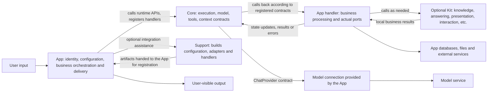
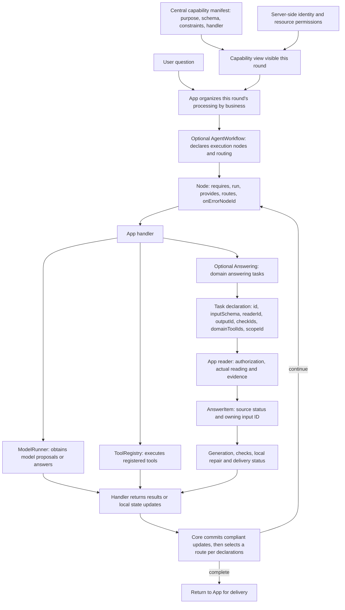
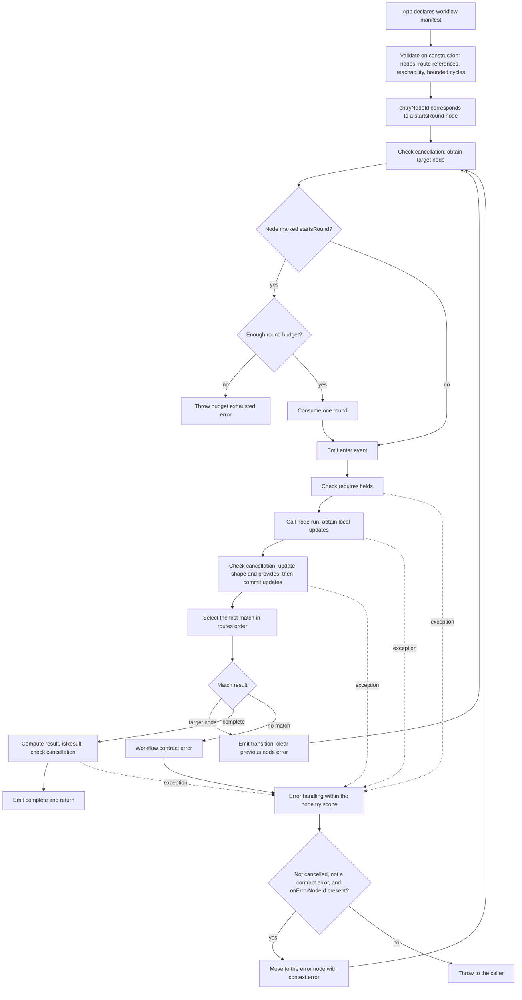
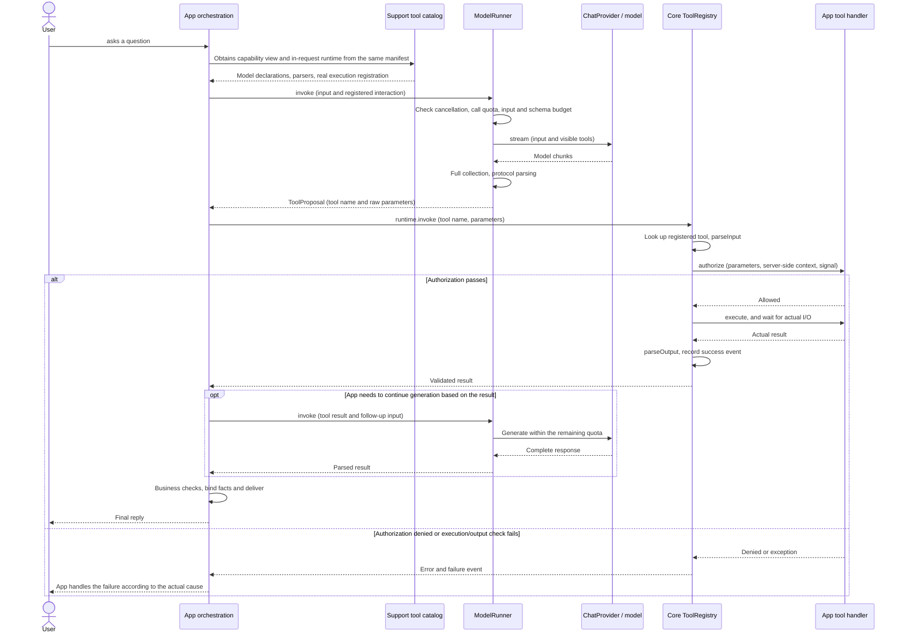
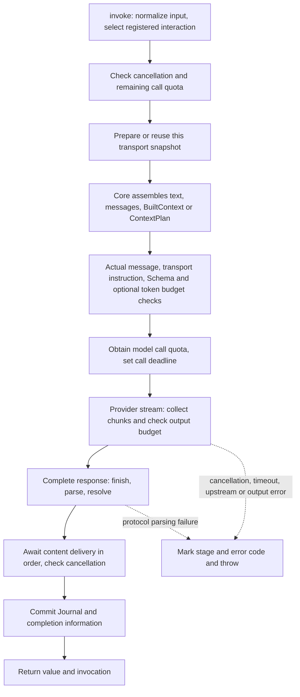
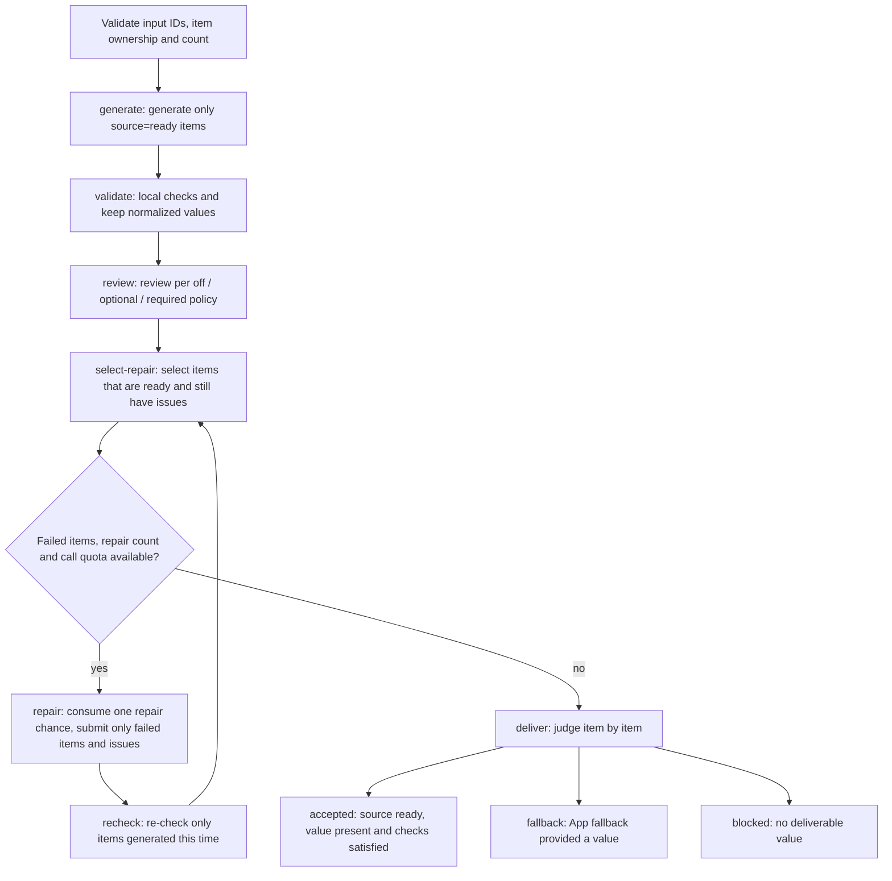
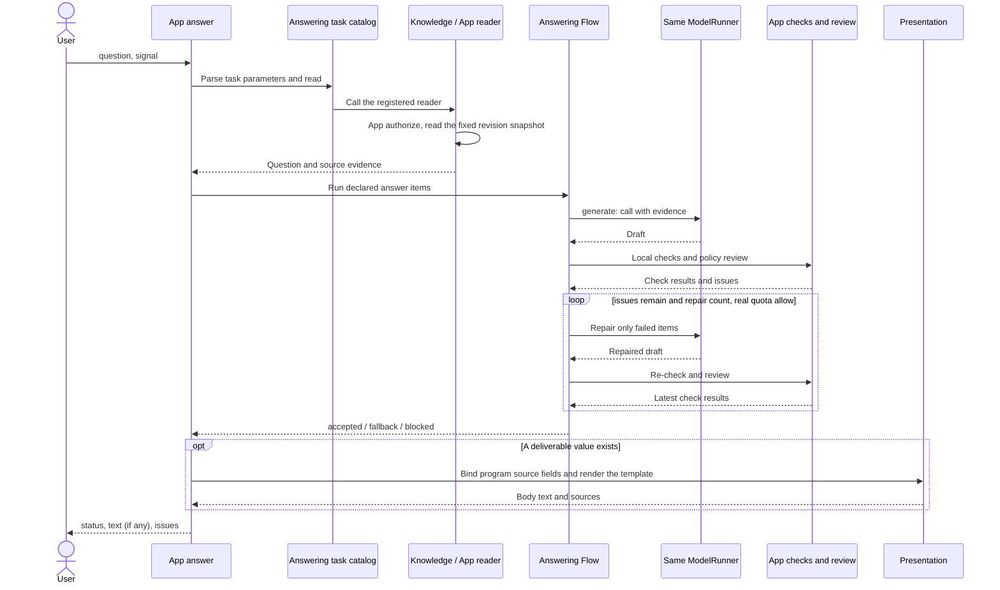

# How the mechanism works

[Back to development handbook](README.md) · [API handbook](api/README.md) · [Knowledge answering contract](api/knowledge-answering.md)

This document explains the current implementation with diagrams. Flows labeled "App composition example" are explicitly orchestrated by the application, not a fixed Agent flow built into Core; Core does not require the App to use Support, Kit, or task decomposition.

## 1. Overall collaboration relationship

Core and App have a call/callback relationship. Support assists the App in integrating the same set of contracts; Kit is chosen one-way by the App, and a Kit may call Core APIs internally, still bound by the same budget, cancellation, and error contracts.

## 2. How task concepts map to execution mechanisms

The three concepts here are different: the **user question** is input, a **workflow node** is an execution stage, and an **answering task/item** is a domain object of the Answering Kit. One node can process multiple answer items; model proposals do not automatically create workflow nodes or install new handlers. A basic `ModelRunner.invoke` call needs neither a workflow nor answering tasks.

## 3. How a Core workflow advances

Corresponds to the actual rules of `AgentWorkflow` and a bound `AgentCoreEngine.run`.

Only entering a node with `startsRound: true` consumes a round; other stages in the same round do not count separately. Every possible cycle (including error routing) must pass through a round boundary. When the entry node omits the field, it starts a round by default. The budget entry check is outside the node's try scope, so exhaustion is not routed to that node's onErrorNodeId. `run(step)` uses an explicit StepOutcome: `{ type: 'continue' }` to continue, `{ type: 'complete', value }` to complete; value may legitimately be undefined.

The commit guard covers only local state updates managed by Core; it does not roll back external writes that the handler has already performed. A failed diagnostic observation does not change business execution.

## 4. Timing from model proposal to actual tool execution

**App composition example**: uses the Support tool catalog, ModelRunner, and the Core tool executor.

The error branch in the diagram also covers input/output check failures in the Registry itself, where a handler call may not occur. A model proposal is not a success receipt, and Core does not automatically execute a tool just because the model proposed its name; whether to call it subsequently, generate again, or end is decided by the App handler/workflow. A failed tool output check also does not mean side effects that already occurred are rolled back.

## 5. Internal flow of one model call

Core is responsible for generic input assembly and final budget checks and does not implicitly select or compress. When processing is needed, the App registers Support or custom processing nodes into the same Workflow and uses ordinary routes to decide when to execute them. Model calls inside processing nodes share the request quota, cancellation, and deadlines; see [Context nodes](api/context-processing.md) for details.

An ordinary invoke does not require prepare in advance. When early measurement is needed, use `model.prepare(...)` to obtain a single snapshot, call `prepared.measure(input)` repeatedly, then still consume the same handle through `model.invoke({ input, prepared })`. Measurement covers the actual transport instructions and Schema; the final check remains in effect, and the handle is not a quota reservation.

`ModelRunner.sink.output` waits in order for consumers of generated chunks, and the fully parsed value is still returned through invoke; `execution.observe.event` is side-channel observation with isolated failures. Chunk preview and final business delivery are different boundaries.

## 6. Task checks and local repair in the Answering Kit

Corresponds to the seven nodes currently registered by `defineAnswerFlow`; this flow exists only when the Kit is adopted.

Initial generation and each repair consume one workflow round; `maxRepairs` additionally limits the number of repairs. `canInvoke` reads the real quota provided by the App, and the Kit does not create an extra model budget. Non-ready sources do not enter generation or repair; items whose review has explicitly failed cannot become passing because review later becomes unavailable. Cancellation, invalid item ownership, and program contract errors throw, and are not automatically disguised as fallback.

## 7. Composition timing of App knowledge answering

The diagram below illustrates an App composition organized by the [Knowledge, Answering, and Presentation contracts](api/knowledge-answering.md); the concrete orchestration and ports are provided by the App. For complete code that can be copied and run directly see [Offline service answering](examples/offline-agent.md); that code does not enable Knowledge/Answering.

If review uses a model, it should consume quota through the same ModelRunner passed in. Fallback evidence and allowed wording are provided by the App; when no deliverable value is provided, blocked is returned. Authorization, reading, cancellation, or contract errors may be thrown directly, with no guarantee of reaching final delivery.
