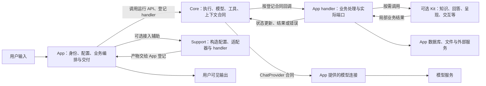
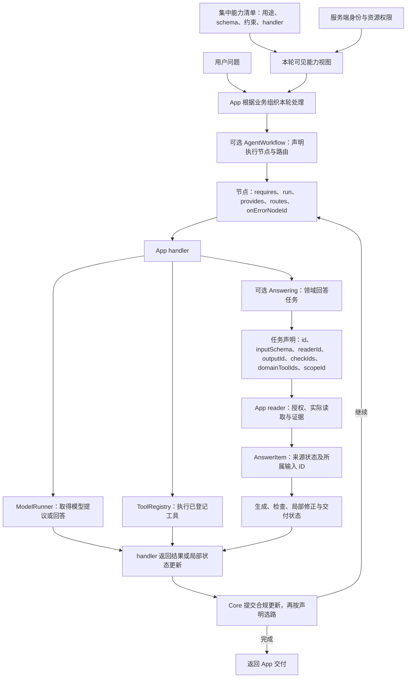
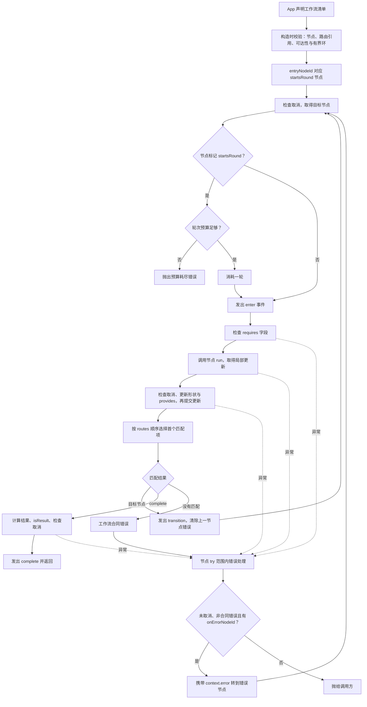
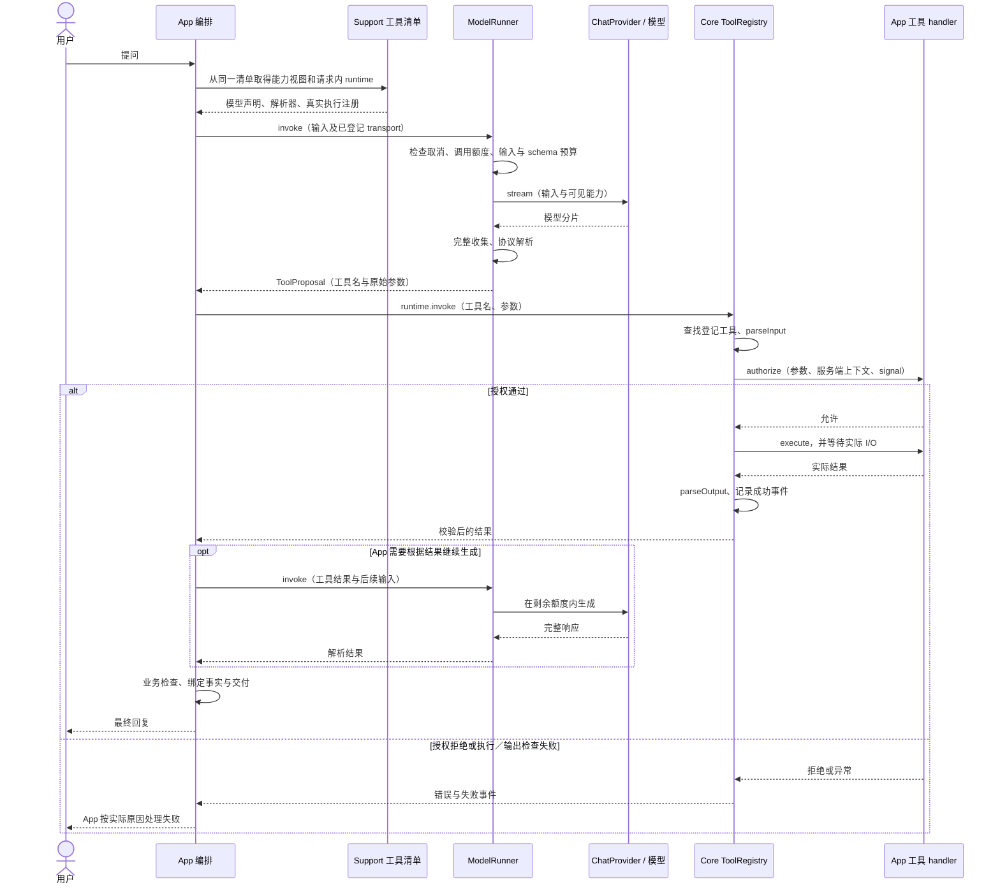
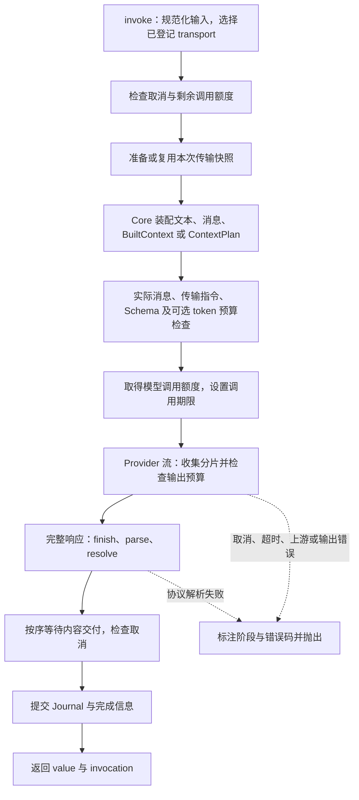
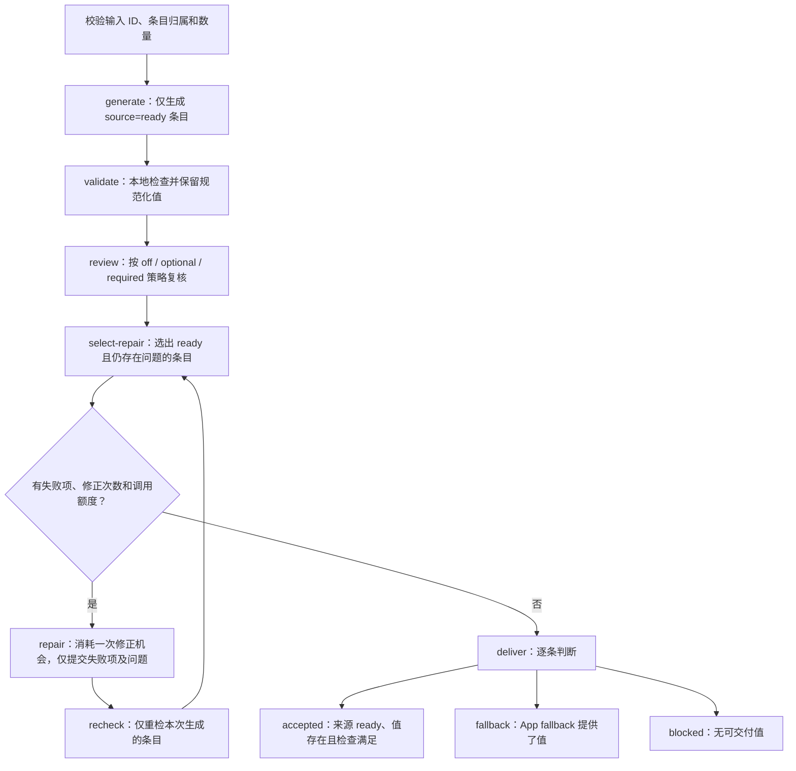
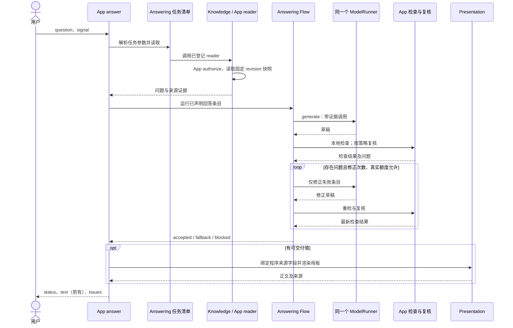

# 工作机制图解

[返回开发指南](README.md) · [API 手册](api/README.md) · [知识回答合同](api/knowledge-answering.md)

本文用图解释当前实现。标为「App 组合示例」的流程由应用显式编排，不是 Core 内置的固定 Agent 流程；Core 不要求 App 使用 Support、Kit 或任务拆分。

## 1. 总体协作关系

Core 与 App 是调用／回调关系。Support 辅助 App 接入同一套合同；Kit 由 App 单向选用，Kit 内也可调用 Core API，继续受同一预算、取消与错误合同约束。

## 2. 任务概念如何对应执行机制

这里的三个概念不同：**用户问题**是输入，**工作流节点**是执行阶段，**回答任务／条目**是 Answering Kit 的领域对象。一个节点可以处理多个回答条目；模型提议不会自动创建工作流节点或安装新 handler。基础 `ModelRunner.invoke` 调用无需工作流或回答任务。

## 3. Core 工作流怎样推进

对应 `AgentWorkflow` 与 绑定后的 `AgentCoreEngine.run` 的实际规则。

只有进入 `startsRound: true` 的节点才消耗一轮，同一轮里的其他阶段不另计轮次；所有可能的环（含错误路由）必须经过轮次边界。入口节点省略该字段时默认开始一轮。预算入口检查在节点 try 范围之外，耗尽不会转入该节点的 onErrorNodeId。`run(step)` 使用显式 StepOutcome：`{ type: 'continue' }` 继续，`{ type: 'complete', value }` 完成；value 可以合法地是 undefined。

提交保护只覆盖 Core 管理的局部状态更新；它不回滚 handler 已发生的外部写入。诊断观察失败不会改变业务执行。

## 4. 模型提议到工具实际执行的时序

**App 组合示例**：使用 Support 工具清单、ModelRunner 与 Core 工具执行器。

图中错误分支也覆盖 Registry 自身的输入／输出检查失败，不一定发生 handler 调用。模型提议不是成功回执，Core 不会因为模型提出工具名就自动执行；后续是否调用、再生成或结束由 App handler／工作流决定。工具输出检查失败也不代表已发生的副作用被回滚。

## 5. 一次模型调用的内部流程

Core 负责通用输入装配与最终预算检查，不隐式选择或压缩。需要处理时，App 将 Support 或自定义处理节点登记到同一 Workflow，并用普通路由决定何时执行。处理节点内的模型调用共享请求额度、取消和期限；详见[上下文节点](api/context-processing.md)。

普通 invoke 不需要预先 prepare。需要提前测量时，用 `model.prepare(...)` 获得单次快照，反复 `prepared.measure(input)` 后仍通过 `model.invoke({ input, prepared })` 消费同一句柄。测量覆盖实际传输指令和 Schema；最终检查继续有效，句柄不是额度预约。

`ModelRunner.sink.output` 按顺序等待生成分片的消费者，完整解析值仍经 invoke 返回；`execution.observe.event` 是失败隔离的旁路观察。分片预览与最终业务交付是不同边界。

## 6. Answering Kit 的任务检查与局部修正

对应 `defineAnswerFlow` 当前注册的七个节点；采用该 Kit 时才有这一流程。

初次生成和每次 repair 各消耗一个工作流轮次；`maxRepairs` 另外限制修正次数。`canInvoke` 读取 App 提供的真实额度，Kit 不额外创建模型预算。非 ready 来源不进入生成或修正；复核已明确失败的条目，不能靠后来复核不可用而变成通过。取消、无效条目归属和程序合同错误会抛出，不自动伪装成 fallback。

## 7. App 知识回答的组合时序

下图是按[Knowledge、Answering 与 Presentation 合同](api/knowledge-answering.md)组织的 App 组合示意，具体编排和端口由 App 提供。可直接复制运行的完整代码见[离线服务问答](examples/offline-agent.md)；该代码不启用 Knowledge／Answering。

复核若使用模型，应通过传入的同一个 ModelRunner 消费额度。fallback 的证据和允许文案由 App 提供；未提供可交付值时返回 blocked。授权、读取、取消或合同错误可直接抛出，不保证走到末尾交付。
